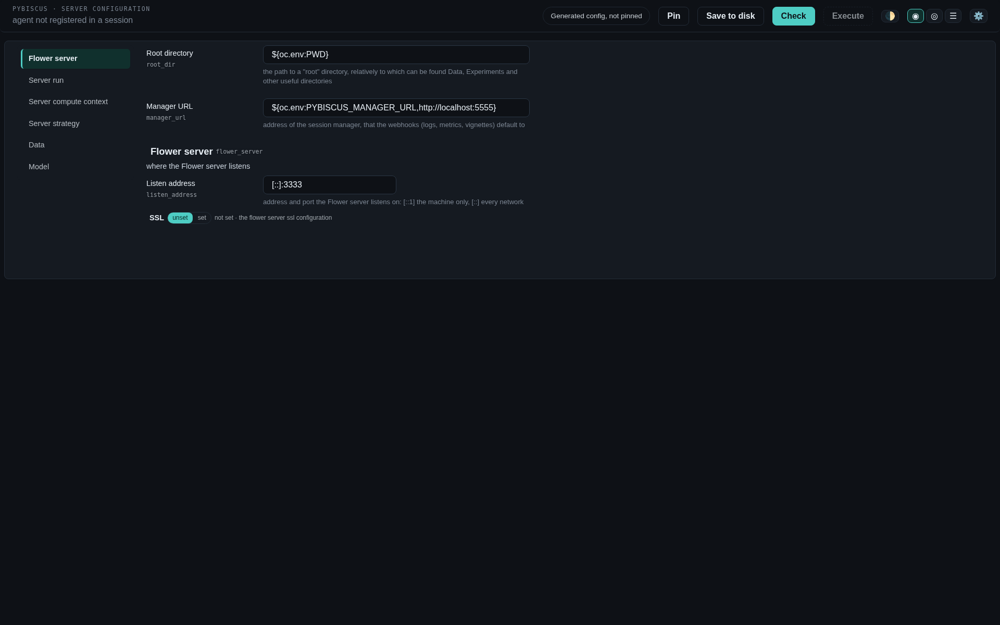
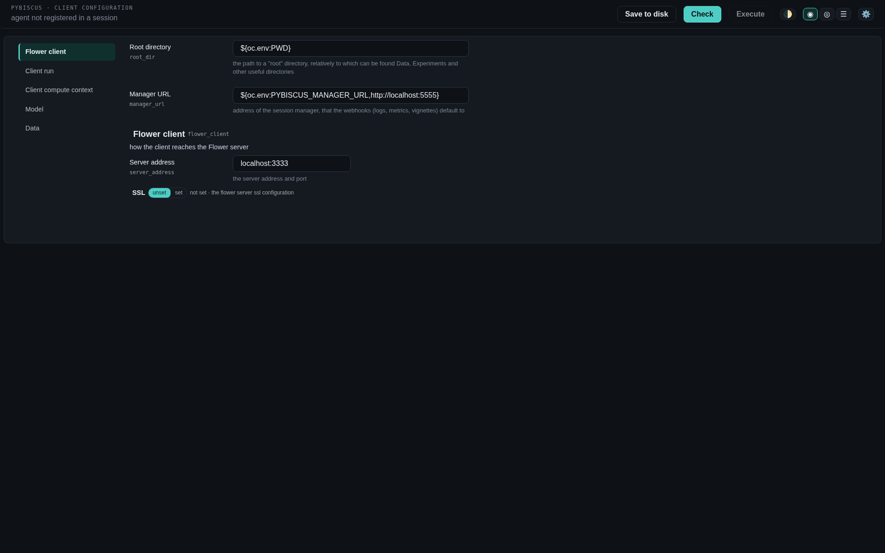

# Agent: configuring and launching from the browser

Install Pybiscus first ([Getting started](getting_started.md#installation)).

The agent (`pybiscus_agent`) is a small web application, one per site: it generates the server or
client configuration form from the configuration models (every plugin included, every field
described on hover), checks the configuration and launches the server or the client. It can be
used alone, as below, or driven by the session manager
([Session using the manager](sessionmanager.md)).

Launch the server agent, then open the URL it prints (`http://localhost:5000/server/config`,
with `?token=…` when it requires one):

```bash
./launch/agent/cli/5000.sh
```



Launch the client agents, and open `http://localhost:5001/client/config` and
`http://localhost:5002/client/config`:

```bash
./launch/agent/cli/5001.sh
./launch/agent/cli/5002.sh
```



On each form, the top bar stays in view when scrolling: the form's name, and the agent's name,
role, site and bouquet when it is registered in a session, then the buttons. The sections are
listed on the left (on top when the window is narrow); the shown one has its description under its
name. A nested block is marked by a rule on its left, in teal for the block under the
pointer; a list has a sunk background.
A list shows its items as a chain, the current one's values under it: ← ➖ → under the current item
move it or remove it, ➕📝 next to the list's name adds an item at the end, ⊞ shows every item.

On each form:
- **Check** validates the configuration; **Execute** (enabled once it is checked)
  launches the server or the client. Launch the server first, then the clients.
  A refused configuration shows each error in red under its field, or on the block it is about
  (an unknown key, a whole section); the form opens the section of the first one. An error the form
  has no place for, or a failure that is not a validation error (a missing plugin), is shown under
  the buttons. After a check, each entry of the section menu carries the number of its errors in red,
  or a green ✓; the mark goes when the section is changed, its state being unknown until the next
  check.
- **Save to disk** downloads the YAML file, to use with the [CLI](cli.md).
- On the server: **Pin** keeps the current form for the next visits, **Blank**
  returns to the defaults; a badge shows where the displayed configuration comes from (pinned, or
  generated and not pinned).
- Each field shows a readable label (its `title`, or its key spelled out: `num_rounds` reads
  "Number of rounds") with its YAML key under it in small type, the name the config files, the CLI
  and the check's errors use. A plugin gives a field a better label with `Field(title=...)`.
- An optional field shows *unset | set* next to its name: *set* shows its value to fill; *unset*
  leaves it unset (None) and folds it, with its description to say what that means (from
  `Field(description=...)`). A field the session locks shows its choice, without changing it.
- 🌓 switches between the dark theme (the default) and the light one; ◉ ◎ ☰ choose how long
  option lists are shown; the ⚙ panel sets the display (tabs, compact lists).

Once launched, the page switches to the run monitor: the run's state and its log lines, live,
with a button to stop it. Above the log, the progress: on a server, the round out of the session's
rounds with a bar and the phase of the round (training on the clients, testing on the server,
evaluating on the clients); on a client, the round and its phase (a client is not told the number
of rounds). Next to it, the last value of the main metric of each phase and the last round's
duration. The log shows all its lines, the rounds' events only, or the warnings and errors.

Every page of the agent is dark by default; its 🌓 button switches to light, kept by the browser for
this agent and followed by its other open pages. A form shown in the manager (the server's
configuration) takes the manager's theme.


The agent listens on 127.0.0.1 by default; see [Access tokens](sessionmanager.md#access-tokens)
and [Session spread over several machines](multi-machine.md) to reach it from elsewhere.
