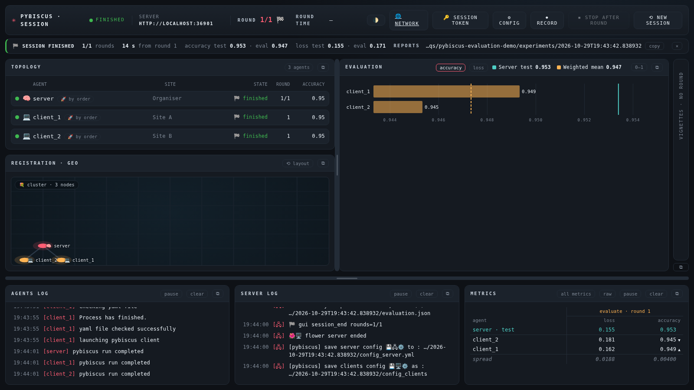

# Federated evaluation of an ONNX model

A model trained elsewhere, shipped as a single `.onnx` file, is evaluated by each site on its own
data: no training, no aggregation, no code of the model's provider. What comes back is a table, one
row per site, and the server's test on a reference set.

Typical uses: compare a vendor's model on the data of several hospitals or plants before buying it;
check how a model trained on some sites generalises to sites it never saw; follow a deployed model's
quality site by site.

## How it works

Three plugins and a core option, no change to the federated loop:

| piece | role |
|---|---|
| `onnxmodel` model ([reference](plugins-reference.md#onnxmodel--onnx-model-evaluation-only)) | runs the `.onnx` file with onnxruntime: a model without any torch parameter, which refuses to train |
| `evaluateonly` strategy decorator ([reference](plugins-reference.md#evaluateonly--evaluateonly)) | no client is asked to train: each round evaluates the server's model on the server's test data and on each client's validation data, and writes the per-site report |
| `server_run.reporting.onnx_export.external_data: false` | the export at the end of a training session writes one file, the weights inside: the form `onnxmodel` evaluates |

The roles, as in a federated benchmark:

- **the organiser** publishes the file and its SHA-256, and runs the server, which tests the model on
  a reference set (the server's `data` section, mandatory);
- **each site** deposits the file, at the same path on every site in a session (the session imposes
  the path and the hash), and evaluates it on its `val` section;
- **the model's provider** gives the file only. The graph must hold its preprocessing
  (normalisation, resizing): the batches reach it as the data plugin produces them.

## Quick start (one machine)

```bash
# 1. a short MNIST session that exports its final model (configs/mnist_cnn/distributed/server.yml)
launch/uv/mnist_cnn/distributed/server.sh      # then client1.sh and client2.sh, in two other shells

# 2. publish its model as the file the evaluation reads (experiments/published/mnist_cnn.onnx)
launch/uv/onnx_eval/prepare.sh                 # prints its SHA-256

# 3. the evaluation: a server and two clients, one round, nothing trains
launch/uv/onnx_eval/server.sh                  # then client1.sh and client2.sh
```

The file and its hash come from `PYBISCUS_ONNX_MODEL` and `PYBISCUS_ONNX_SHA256`
(`launch/uv/onnx_eval/common.sh` computes the hash of the local file, which suits one machine only:
on several, the organiser gives it and each site sets it). Without them, the configurations'
default hash refuses every file.

## Configuration

The model, the same on the server and the clients
([configs/onnx_eval/](../configs/onnx_eval/)):

```yaml
model:
  name: onnxmodel
  config:
    path: experiments/published/mnist_cnn.onnx
    sha256: 28b030bd…                     # 64 hexadecimal digits: another file is refused
    output_kind: logits                   # logits, probabilities, labels or regression
    num_classes: 10
    class_rates: per_class                # none (default), per_class or confusion_matrix: an exact F1
    # input_name, output_name: the graph's only input and its first output by default
    # providers: [CUDAExecutionProvider, CPUExecutionProvider]   # each site its own
```

| `output_kind` | metrics |
|---|---|
| `logits` | `loss` (cross-entropy), `accuracy` |
| `probabilities` | `loss` (cross-entropy of the probabilities), `accuracy` |
| `labels` (class indices) | `loss` (the error rate: no score to take a cross-entropy of), `accuracy` |
| `regression` | `loss` (mean squared error), `mae` |

An exact macro F1 for a classification: `num_classes` and `class_rates: per_class` (or
`confusion_matrix`, every cell too). Each site then returns, for each class, its true positives,
false positives and false negatives as shares of its examples; the report gives `f1_macro` per site
and for the sites together, computed from their rates weighted by their examples, and the precision,
recall and F1 of each class. Off by default: the rates tell each site's share of each class.

The server's pipeline:

```yaml
server_run:
  num_rounds: 1           # the model does not change from one round to the next
server_strategy:
  pipeline:
  - name: evaluateonly
    config:
      report_name: evaluation
      section: val        # val (default) or test: the section of its data each site evaluates on
```

`section: test` has each site evaluate on its `test` section, its own labelled test data (its
`test.dir`, its `max_samples`), rather than on its validation data.

### Following a deployed model

A model in production evaluated on each site's new data at fixed times, every night for instance:
the server's `schedule` gives the rounds, and the clients' `refresh_data` reads their data again
before each one.

```yaml
server_run:
  num_rounds: 30
  schedule: {cron: "0 2 * * *"}    # every day at 02:00
# each client
client_run:
  refresh_data: true                # its data read again before each evaluation
```

A round without training counts once a site has evaluated in it; a site without new data
(an incremental module such as `hdfs` with `train.lots: new` and `val.source: holdout`) leaves it,
and a round no site evaluated in does not count, or ends the session with
`stop_without_new_data`. The report keeps a line per round: the model's metrics site by site, night
after night.

The file is refused, and the run stops at its launch, when its SHA-256 differs from the
configuration's, when it is larger than `max_size_mb` (2 GB at most, the limit of a single ONNX
file), or when it keeps tensors in external data files (`model.onnx.data`: the hash would not cover
the weights). The bytes hashed are the bytes run, read once. To embed external data:
`onnx.save_model(onnx.load(path), path, save_as_external_data=False)`, or
`torch.onnx.export(..., external_data=False)`.

## The report

At each round, `evaluation.json` and `evaluation.csv` in the server's reporting directory:

```
round,site,num_examples,loss,accuracy,f1_macro
1,server,,0.156289,0.9515,0.951585
1,0,3000,0.180728,0.9453,0.944894
1,1,3000,0.161902,0.9493,0.947857
1,weighted_mean,6000,0.171315,0.9473,0.946380
```

`evaluation.json` also names the model evaluated (its configuration, its hash) and the number of
sites that failed; with `class_rates`, the rates, the scores of each class (`classes`) and the
`confusion_matrix`, which the CSV leaves out (only `f1_macro` there). The weighted mean is Flower's
own aggregate of the sites, its F1 derived from their rates. The server does not report its number
of examples.

## In a session of the manager

In the session's configuration, set `purpose` to `evaluation`, choose the *ONNX model (evaluation
only)* model and set its path and hash: they are imposed and locked on every form, the providers left
to each site. The server's pipeline starts with the `EvaluateOnly` decorator, set and locked, and the
session runs one round unless `num_rounds` says otherwise
([details](sessionmanager.md#session-parameters)). Nothing in the agents' own configurations needs to
say it is an evaluation. With `data_partition` and `data_holdout`, each site evaluates on examples
held out of its own share. Another model is evaluated the same way from the server's `weights_path`.



The manager shows the *evaluation* panel in place of its two charts: a bar per site, sorted, the
server's test and the sites' weighted mean across them, the scale fitted to the values (*0–1* for the
whole scale) ([details](sessionmanager.md#7-follow-the-session)). The metrics table keeps its row per
site. `launch/doc/evaluation_shot.py` replays such a session and takes this screenshot;
`launch/doc/scenarios/evaluation-session.yml` films one ([Recording a session](recording.md#a-simple-session)).

## What leaves a site

Its metrics on its validation data (loss, accuracy or mae, its number of examples) and the logs of its
runs, as in any session. With `class_rates`, its share of each class, of each class's errors (and of
each cell of its confusion matrix). No prediction, no example, no update of the model: the parameters the
server sends are empty.

## Limits

- **One file up to 2 GB**: a larger model needs external data, refused for now.
- **Standard operators only**: no custom operator library is loaded.
- **Accuracy, loss, mae, macro F1**: the F1 from additive per-class rates (`class_rates`); an AUC,
  which needs every score, is not computed.
- **A wrong input contract gives plausible but wrong metrics**: check a new model once against the
  framework it was trained with (`launch/ci/smoke.sh evaluation` does it for the MNIST demo: ONNX and
  torch agree within 1e-4 on the server and on each site).
- **A hierarchical session** cannot be an evaluation yet.

## Related work

Federated evaluation, or *model-to-data*, exists in other frameworks; they carry the model in their
own format or in a container:

- MedPerf (MLCommons), federated benchmarking of medical AI: models in MLCube containers, a
  committee fixing the data preparation, the reference model and the metrics; only the metrics leave
  a site. Karargyris et al., *Federated benchmarking of medical artificial intelligence with
  MedPerf*, Nature Machine Intelligence 5, 799–810 (2023), doi:10.1038/s42256-023-00652-2.
- NVIDIA FLARE, [cross-site model evaluation](https://nvflare.readthedocs.io/en/2.5/programming_guide/controllers/cross_site_model_evaluation.html):
  every model evaluated by every site, a matrix of the results.
- OpenFL, [federated evaluation](https://openfl.readthedocs.io/en/v1.8/about/features_index/fed_eval.html):
  a plan reduced to a validation pass, the evaluation phase of the FeTS challenge (Pati et al.,
  *The Federated Tumor Segmentation (FeTS) Challenge*, arXiv:2105.05874, 2021).
- Flower, [federated evaluation](https://flower.ai/docs/framework/main/en/explanation-federated-evaluation.html)
  (`fraction_evaluate`, `evaluate_fn`).
- Wang et al., *Federated Evaluation of On-device Personalization*, arXiv:1910.10252 (2019).
- Guinney and Saez-Rodriguez, *Alternative Models for Sharing Confidential Biomedical Data*, JMIR
  2020, doi:10.2196/18087: the model-to-data framework, and its limits.

Here the model travels as an ONNX file, verified by its hash, run by the same runtime on every
site, without the provider's code or container.
