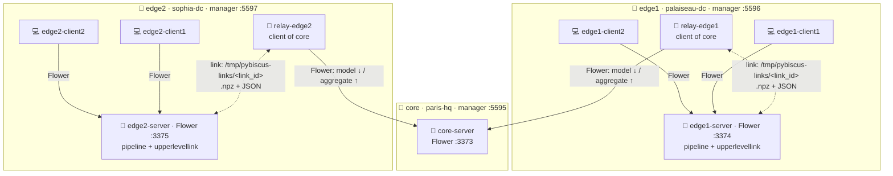
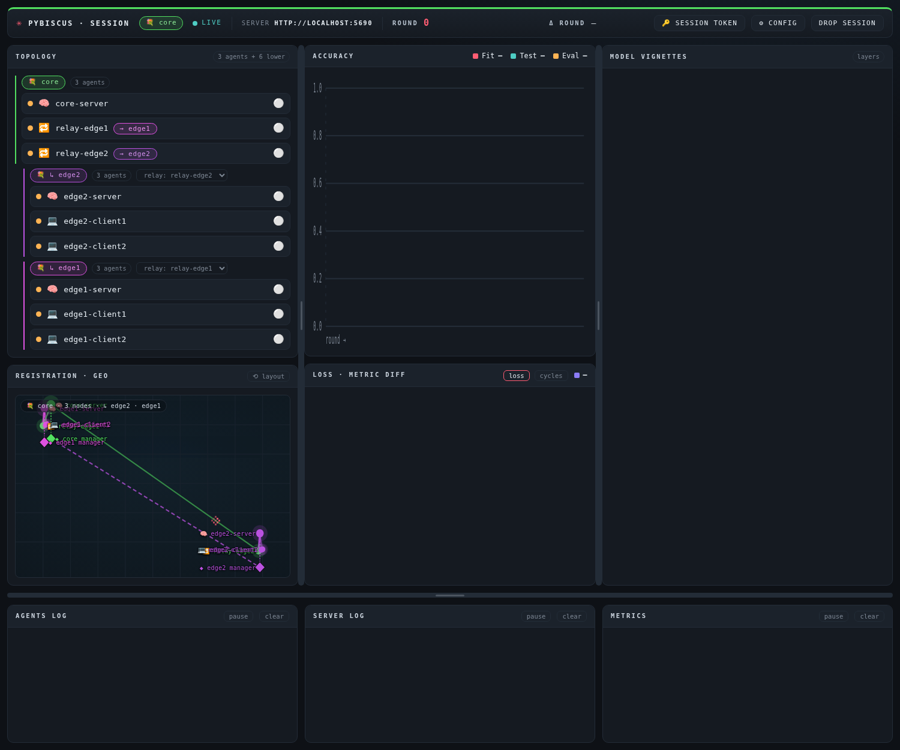
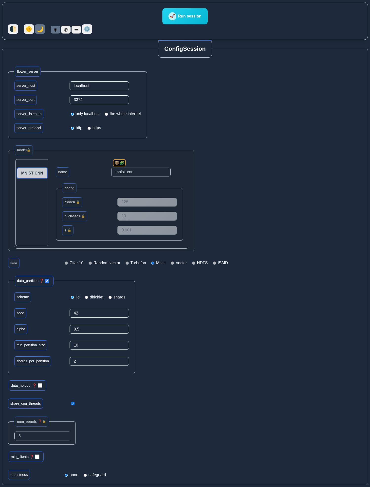
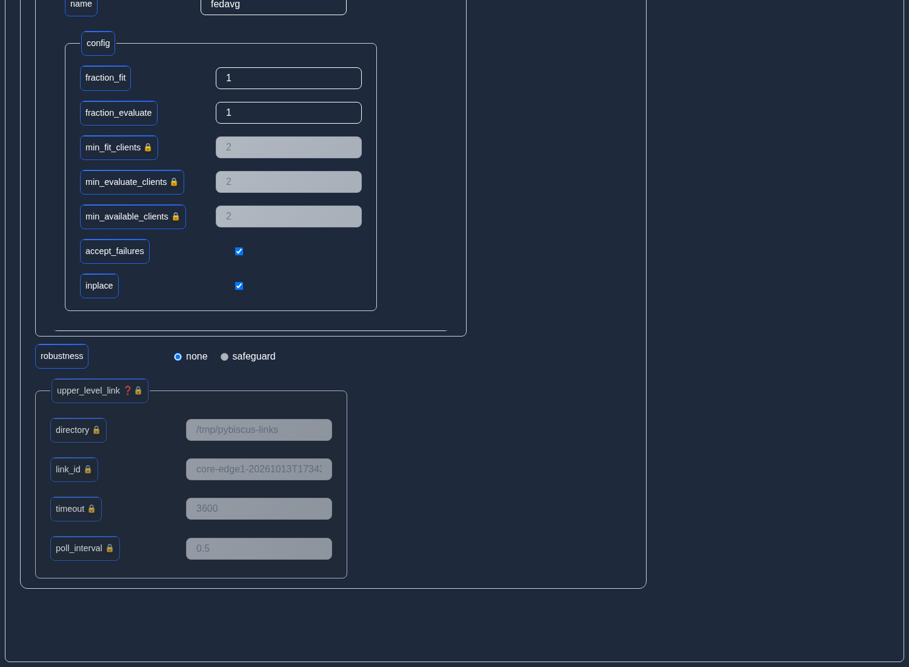
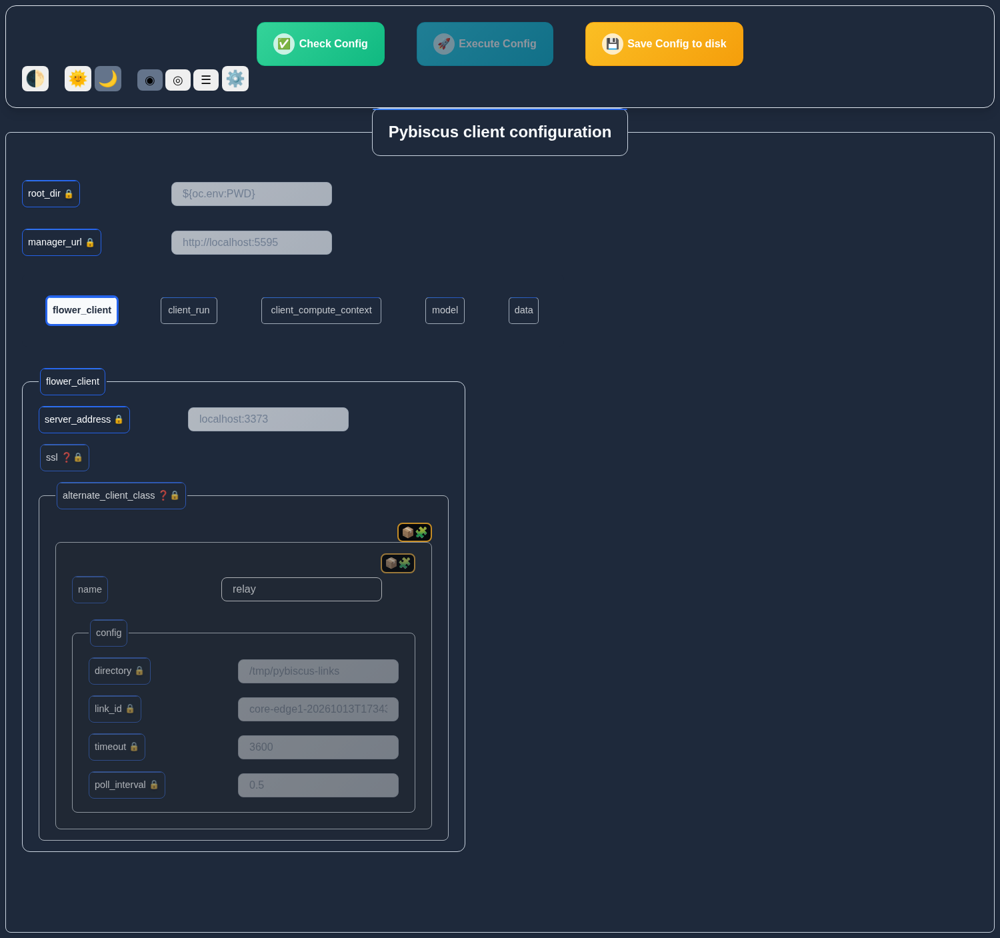
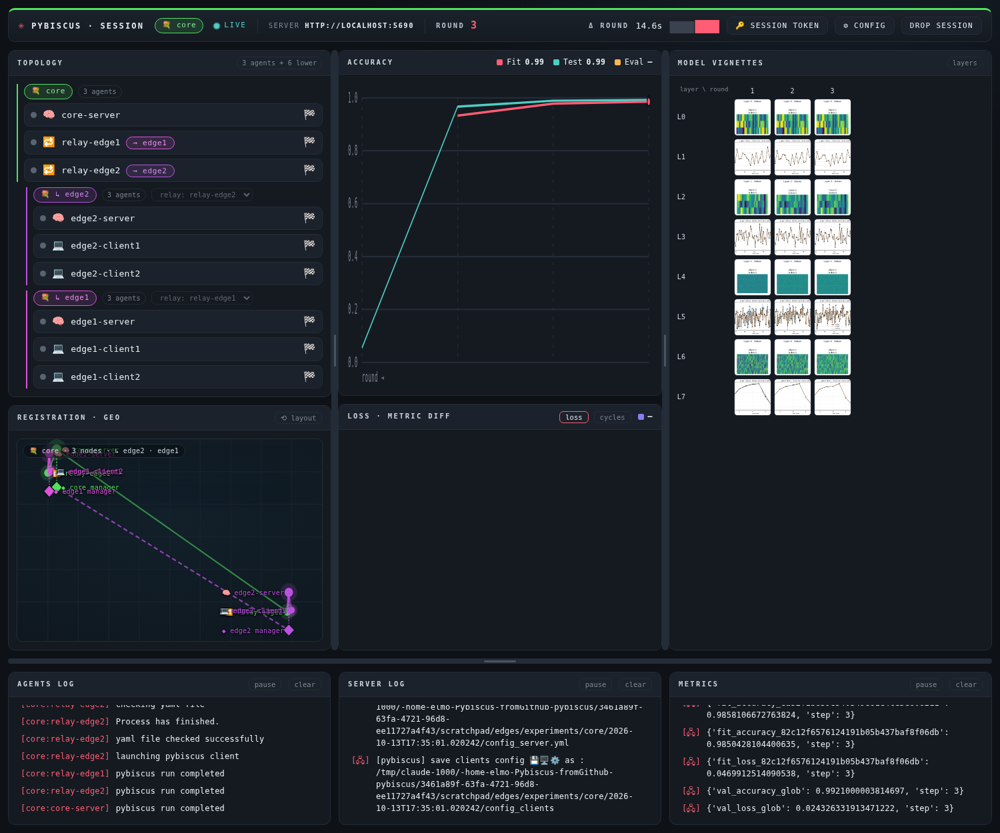
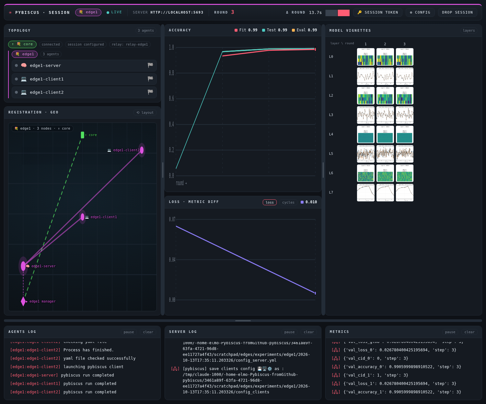
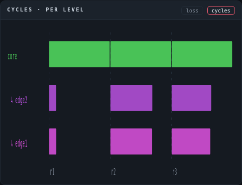

# Hierarchical session: one core, two edges

*Experiment of 2026-10-13, on one machine (mnist, 3 rounds). The mechanisms are described in
[Session using the manager](sessionmanager.md#bouquets-of-a-hierarchical-session).*

A **core** session federates two **edge** sessions. The core has no data client of its own: its
only clients are two **relays**, each standing for a whole edge session. Each edge trains on its
own data, round for round with the core: in round `r`, the core's model goes down to both edges
through their relays, each edge trains a round on it with its own clients, and its aggregate goes
up as the relay's result, weighted by the edge's examples.

## Deployment



| Bouquet | Manager | Agents | Role |
|---|---|---|---|
| core | 5595 (`--bouquet core`) | 5690 core-server, 5691 relay-edge1, 5692 relay-edge2 | server, 2 relays |
| edge1 | 5596 (`--upper-url http://localhost:5595`) | 5693 edge1-server, 5694–5695 clients | server + `upperlevellink`, 2 clients |
| edge2 | 5597 (`--upper-url http://localhost:5595`) | 5696 edge2-server, 5697–5698 clients | server + `upperlevellink`, 2 clients |

A relay runs on the machine of the edge server it stands for: they share the link directory. The
managers exchange only what the levels need: downwards the session's constraints (model and its
hyperparameters, data plugin, number of rounds) and the link; upwards the topology (agents, states,
relays) and the cycles (durations per round).

## Reproduce

From the repository root, every agent with the hierarchical plugins' manifest:

```bash
export PYBISCUS_PLUGIN_CONF_PATH=pybiscus-plugins/plugins-conf.yml:pybiscus-plugins-hierarchical/plugins-conf.yml
uv run session_manager --port 5595 --bouquet core  --location paris-hq     --geo 48.8566,2.3522 &
uv run session_manager --port 5596 --bouquet edge1 --location palaiseau-dc --geo 48.7144,2.2028 --upper-url http://localhost:5595 &
uv run session_manager --port 5597 --bouquet edge2 --location sophia-dc    --geo 43.6163,7.0552 --upper-url http://localhost:5595 &
for port in 5690 5691 5692 5693 5694 5695 5696 5697 5698; do uv run pybiscus_agent --port $port & done
```

Register each agent in its bouquet's manager (registration page of the agent): the core server and
the two relays — ordinary clients — in `core`, each edge's server and clients in its edge.

## Walkthrough

**1. Designate the relays.** The core's topology shows each edge, reported by its manager, under the
core's own agents. Each edge gets its relay among the core's clients (the list beside the edge's
name); the core refuses to launch while an edge has none.



**2. Configure the core session.** Model (here MNIST CNN with its hyperparameters), data plugin and
`num_rounds` (required with lower levels). At launch the core manager makes one link per edge, with
a new `link_id`.

**3. Configure each edge session.** Its form opens with the core's model, hyperparameters, data and
number of rounds set and locked; the rest (data partition between its clients, holdout, robustness…)
stays the edge's own.



**4. Launch the servers, then the clients.** The edge server's form holds the link to the core,
locked (`server_strategy.upper_level_link`), which adds the `upperlevellink` decorator last to its
pipeline. The relay's form holds the relay plugin and the same link, locked.





**5. Follow the session.** The core's page shows the whole tree, its curves and the edges' agents'
states; each edge's page shows its own session and, at the top, its link to the core.





The *cycles* tab of the core shows, per round, the core's round and the share of it each edge
worked on (from the core's model's arrival to its aggregate's departure):



## Results

Server-side test accuracy (mnist test set of each server), the same model at round 0 on every
level: the edges evaluate the core's initial model, not one of their own.

| Round | core | edge1 | edge2 |
|---|---|---|---|
| 0 | 0.055 | 0.055 | 0.055 |
| 1 | 0.967 | 0.967 | 0.973 |
| 2 | 0.989 | 0.988 | 0.988 |
| 3 | 0.992 | 0.991 | 0.992 |

Cycles seen by the core (seconds): the core's round, and each edge's work in it. The first round
includes the launch of the agents one after the other.

| Round | core round | edge1 work | edge2 work | examples per edge |
|---|---|---|---|---|
| 1 | 96.6 | 11.4 | 11.4 | 59 904 |
| 2 | 13.3 | 9.1 | 9.2 | 59 904 |
| 3 | 14.6 | 9.3 | 9.6 | 59 904 |

The core aggregates 2 results per round (its relays); its federated evaluation receives 0 results
and 2 failures — the relays hold no data, each edge evaluates every model on its own — and the
session goes on.
