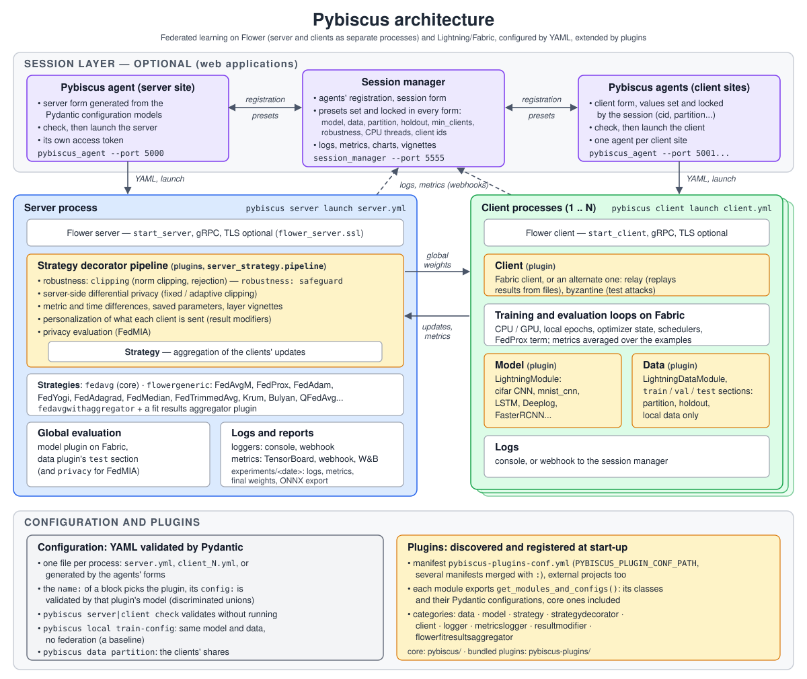

# Plugins information

# Plugin Development

## Model and Data Provider Development

For detailed instructions on creating custom models and data providers, refer to the [PyBiscus Integration Guide](pybiscus_model_guide.md).

This document covers plugin directory structure and registration mechanisms...




Their source code can be located in several locations according to their type: 
- in a specific package pybiscus source tree (for those of general interest)
- in their specific source tree, referenced by category in the plugin definition yaml file. 
Meaning you have the ability to embed code originating from an external repository.

They shall implement an interface defined in *pybiscus.interfaces* package.
Their package shall provide a specific entry point *get_modules_and_configs()* in its *__init__.py* file that is checked at launch for a run-time discovery. [More technical info in How-to](how-to.md)

Abbreviated packages representation used in the following array :
- ⚡.🔥 lightning.pytorch
- 🌺.🤖 pybiscus\.ml
- 🌺.🌼 pybiscus.flower
- 🌺.🔘 pybiscus.core
- 🌺.🔌.🔘 pybiscus.interfaces.core
- 🌺.🔌.🌼 pybiscus.interfaces.flower

|Implemented interface|Source tree location|Plugin type definition|
|:--------------------|:-------------------|:--------------------:|
|⚡.🔥.LightningDataModule|🌺.🤖.data|data|
|⚡.🔥.LightningModule|🌺.🤖.models|model|
|🌺.🔌.🔘.metricsloggerfactory.MetricsLoggerFactory|🌺.🔘.metricslogger|metricslogger|
|🌺.🔌.🔘.logger.LoggerFactory|🌺.🔘.logger|logger|
|🌺.🔌.🌼.fabricstrategyfactory.FabricStrategyFactory|🌺.🌼.strategy|strategy|
|🌺.🔌.🌼.strategydecorator.StrategyDecorator|🌺.🌼.strategydecorator|strategydecorator|
|🌺.🔌.🌼.clientfactory.ClientFactory|🌺.flower_fabric.client|client|
|🌺.🔌.🌼.flowerfitresultsaggregator.FlowerFitResultsAggregator|🌺.🌼.flowerfitresultsaggregator|flowerfitresultsaggregator|
|🌺.🔌.🌼.resultmodifier.ResultModifier|🌺.🌼.resultmodifier|resultmodifier|
|🌺.🔌.🌼.stoppingcriterion.StoppingCriterion|🌺.🌼.stoppingcriterion|stoppingcriterion|

## Loading: what stops Pybiscus, what does not

At start-up, every module of the manifest is imported and its `get_modules_and_configs()` called.
It returns `(class, config)` pairs, `[(LitCNN, ConfigModel_Cifar10)]`: each class is registered
under its config's `name` `Literal`, written once. The former `({"cifar": LitCNN},
[ConfigModel_Cifar10])` is still accepted.

- A plugin whose **third-party dependency is missing** is skipped with a warning
  (`⚠️ 🧩 Plugin '…' skipped: missing dependency '…'`): the other plugins keep working, and a
  configuration that names the skipped one is refused with the list of skipped plugins.
  `PYBISCUS_PLUGINS_STRICT=1` turns this into an error.
- Everything else is an error that stops the command (exit code 78) with its cause: a manifest
  that cannot be read, a path that does not exist, a plugin not found or failing to import, a
  plugin **shadowed** by another module of the same name (plugins are top-level modules: name
  yours so that no installed package has that name), a config without a `name` `Literal` or not
  derived from `BaseModel`, (former format) a registry key that differs from its configuration's
  `name`, two plugins registering the same key.
- `PYBISCUS_PLUGINS_VERBOSE=1` prints the details of the loading.

## A plugin's dependencies

Each plugin package carries a `requirements.txt`: one requirement per line (PEP 508, `#` comments),
every third-party package it imports, `torch`, `lightning` and `pydantic` included, without a
version unless the plugin needs one (in the repository, `uv.lock` fixes them). The plugin then
describes itself, whatever Pybiscus installs.

```bash
uv run pybiscus plugins deps             # each plugin of the manifest(s): its requirements, installed or not
uv run pybiscus plugins deps --install   # installs the missing ones
uv run pybiscus plugins deps --declarations   # only: does each plugin declare what it imports
```

It reads the plugins' sources and imports none, so it works while a dependency is missing. It fails
(exit 1) on a plugin without `requirements.txt`, an invalid line, a requirement missing or not
satisfied (its extras included, `torchmetrics[detection]`), or an import the file does not cover
(an import inside `try: … except ImportError:` is optional and not counted). It reads the manifests
of `PYBISCUS_PLUGIN_CONF_PATH`, as the other commands.

- When an extra of Pybiscus provides the missing packages (`privacy-evaluation`), `--install` runs
  `uv sync --inexact --extra=<it>`: the versions of `uv.lock`. Otherwise it runs `uv pip install`
  (pip without uv), which ignores `uv.lock`. Either way, a later `uv sync` without that extra
  removes them (`uv sync --inexact` keeps them).
- `launch/ci/smoke.sh check` runs it on every plugin directory (`--declarations`), and fully on
  the bundled and hierarchical plugins; the container images install every extra and fail their
  build when a plugin's requirements are missing.

## Plugins in a container

The images (`container/build_pybiscus_container.sh`, `build_node_container.sh` for the agent) carry
the repository's plugin directories with every extra installed: their build fails when a plugin's
requirements are missing. A plugin directory of your own goes into an image built on them, not
into a running container (a site may have no network, and its versions would not be the image's):

```bash
container/build_container_with_plugins.sh path/to/myplugins             # image myplugins:<version>
PYBISCUS_IMAGE=pybiscus-agent:0.15.0 container/build_container_with_plugins.sh path/to/myplugins myagent:1
```

`path/to/myplugins` holds its manifest `plugins-conf.yml` (paths relative to it) and the plugins,
each with its `requirements.txt`; it is the build context, copied to `/app/myplugins`
(`container/Dockerfile_with_plugins`). The build installs every `requirements.txt` with
`uv pip install`, which does not read `uv.lock`: pin the versions there (`tinydb==4.8.2`) for a
reproducible image. The image sets `PYBISCUS_PLUGIN_CONF_PATH` to the bundled, the hierarchical and
your manifest, and its build runs `pybiscus plugins deps` on them: a requirement missing or an
import not declared fails the build, not a run.

## Metadata a plugin's configuration may declare

Class attributes (`ClassVar`) of the configuration classes, read by the forms and the validation:

| attribute | on | effect |
|---|---|---|
| `PYBISCUS_ALIAS` | the `name`/`config` class | label shown in the forms instead of its `name` `Literal` |
| `PYBISCUS_GROUP` | the `name`/`config` class | family the option is grouped under in long lists (strategies: Averaging, Server optimizers, Robust aggregation...; decorators: Metrics, Saving, Robustness...) |
| `PYBISCUS_CONFIG` | a nested configuration class | name of its section in the forms (`config`, `train`, `server_run`...) |
| `PYBISCUS_DESCRIPTIONS` | an `Enum` (set after the class) | description of each value, shown on hover |
| `PYBISCUS_INCOMPATIBLE_WITH` | a strategy decorator | decorators it cannot be combined with in a pipeline: refused at `check` |
| `PYBISCUS_AFTER` | a strategy decorator | decorators that must come before it in the pipeline: refused at `check` otherwise |
| `PYBISCUS_LAST` | a strategy decorator | must be the pipeline's last (outermost) decorator: refused at `check` otherwise |
| `PYBISCUS_STRATEGIES` | a strategy decorator | the strategies it works over: refused at `check` with another one |
| `PYBISCUS_CHAINS` | a configuration class | per list field, how the forms draw it as a chain: the field it wraps (`anchor`) and the items its validators add (`implicit`) |
| `PYBISCUS_SERVER_SECTIONS` | a data plugin's configuration | sections the server reads (`test` and `privacy` by default): the server warns when another one differs from its defaults |

The four decorator rules are also flagged in the form as the pipeline is edited, with the check's
messages.

Describe every field with `Field(description=...)`: it is shown under the field in the forms (see the
[integration guide](pybiscus_model_guide.md)), and in the [plugins reference](plugins-reference.md).

## The plugins reference

`docs/plugins-reference.md` describes every bundled plugin: its `name:`, where it comes from, what it
does, its fields (type, default, description) and the shipped configurations that use it. It is
generated from the plugins themselves, not written by hand:

```bash
PYBISCUS_PLUGIN_CONF_PATH=pybiscus-plugins/plugins-conf.yml:pybiscus-plugins-hierarchical/plugins-conf.yml \
  uv run pybiscus plugins doc
```

A plugin's description is the first paragraph of the docstring of its class (the class its
`get_modules_and_configs()` registers), else of its configuration's `config` class. After a change
of a plugin, generate it again: `launch/ci/smoke.sh check` fails when it is not up to date.

# Multi projects mode : developping plugins in separated projects

__The following guidelines, extracted from the _cypia_ plugin project, demonstrate how to structure your development environment so that the Pybiscus core and each plugin are maintained in their own dedicated project.__

This project is a suite of plugins for the Pybiscus federated learning framework:
https://github.com/ThalesGroup/pybiscus
which is itself based on the flower framework:
https://github.com/adap/flower

The intention is to enable a clear separation between the pybiscus core
and its plugins, in order to be able to use external code
without impacting the pybiscus core, particularly to have isolation
between pybiscus dependencies and those of its plugins.

This relies on the use of the uv tool (from Astral)

uv is an ultra-fast Python dependency and environment management tool, compatible with pyproject.toml standards, which replaces pip, pip-tools, virtualenv and setuptools install all at once.

We use the workspace concept for this,
which allows to logically group several projects and
produce a workspace virtual environment that is the fusion of the workspace projects.

## General organization

A workspace directory, in which we will clone the two repositories side by side:

```bash
mkdir workspace
cd workspace
git clone https://github.com/ThalesGroup/pybiscus
git clone https://my-plugin-repository-url/cypia
```

```
workspace/
├── pyproject.toml
├── pybiscus/
├── cypia/
```

## The cypia project structure

```
cypia/
├── .python.version
├── pyproject.toml
├── pybiscus.env
├── cypia-plugins-conf.yml
├── cypia/
│   └── __init__.py
├── workspace/
│   ├── init.sh
│   └── pyproject.toml
```

## The cypia project's pyproject.toml

The project has a dependency on the parent pybiscus project,
in addition to its own dependencies,
as well as an indication that it is part of a workspace:

```

dependencies = [
  "plugin-deps>=1.5.0",
  ...
  "pybiscus",
]

...

[tool.uv.sources]
pybiscus = { workspace = true }

```

## The pybiscus + cypia workspace pyproject.toml

The workspace/init shell must allow initializing the workspace

it copies the pyproject.toml file:

```
[tool.uv.workspace]
members = ["pybiscus", "cypia"]
```

```bash
#!/usr/bin/bash

cp pyproject.toml ..
cd ..
uv sync
```

## Plugin configuration

To specify the definition of the plugins used, you can configure the plugin configuration file (default file: **pybiscus-plugins/plugins-conf.yml**, but configurable via the **PYBISCUS_PLUGIN_CONF_PATH** environment variable) by overriding this variable in the **pybiscus.env** file with these 2 possibilities:

- override the plugin configuration file in order to use only the project plugins :

```
PYBISCUS_PLUGIN_CONF_PATH="./cypia-plugins-conf.yml"
```
- merge several plugin configuration files in order to use both the project plugins and the pybiscus ones :

```
PYBISCUS_PLUGIN_CONF_PATH="../pybiscus/pybiscus-plugins/plugins-conf.yml:./cypia-plugins-conf.yml"
```

## How to develop / execute

Once the workspace has been inited by executing the  workspace/init shell.

By positionning in the cypia directory,
we can access to pybiscus python packages,
and pybiscus shells can be ran using their relative path 
( by example: ../pybiscus/launch/agent/cli/5000.sh )
