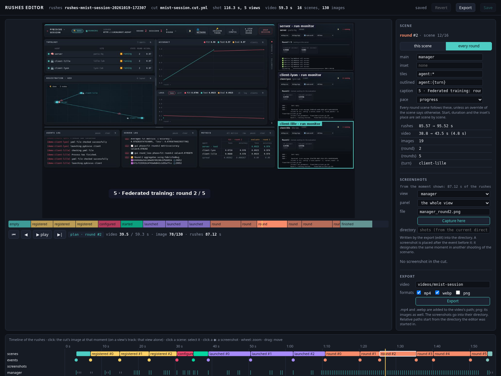
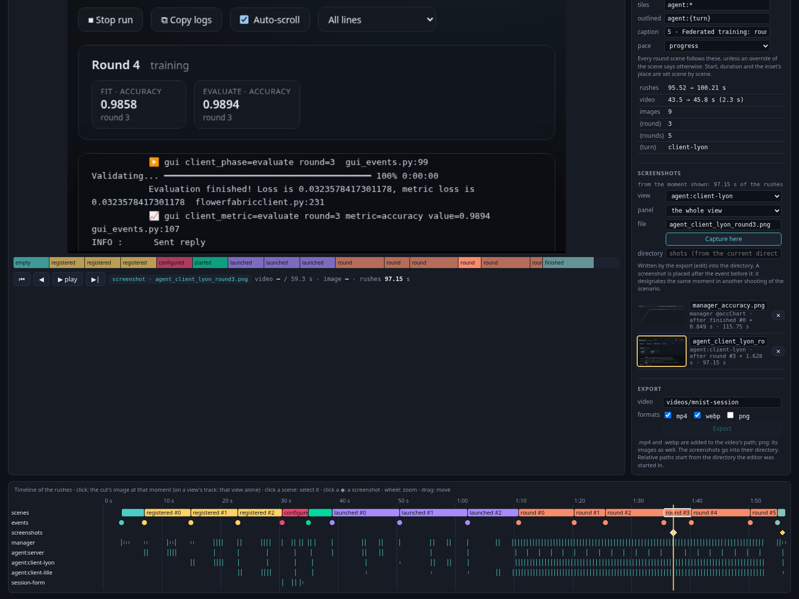
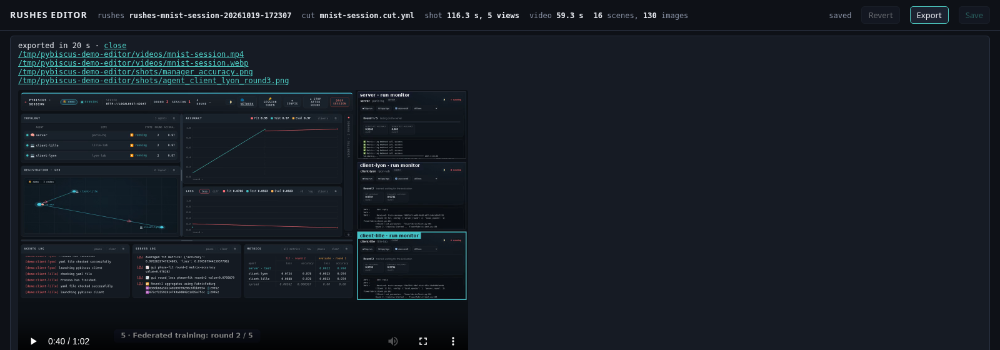
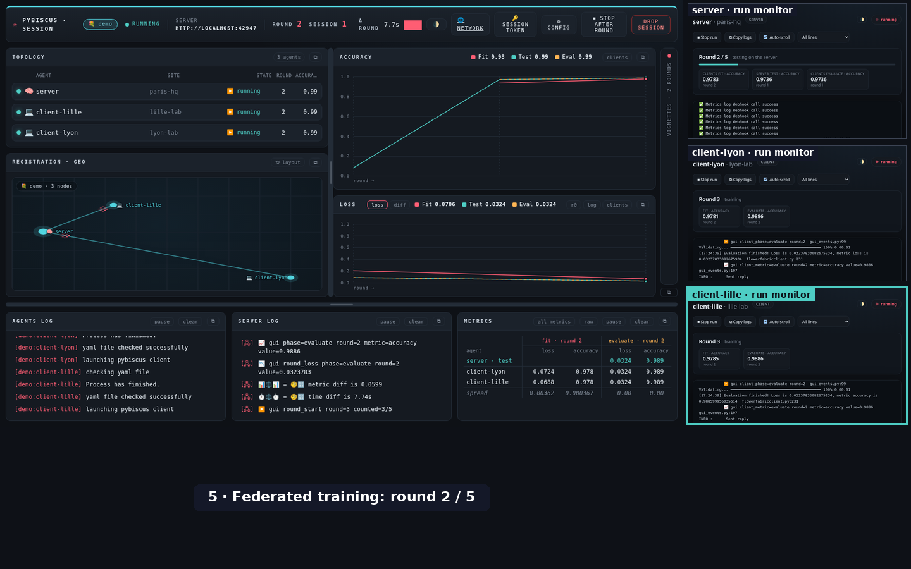
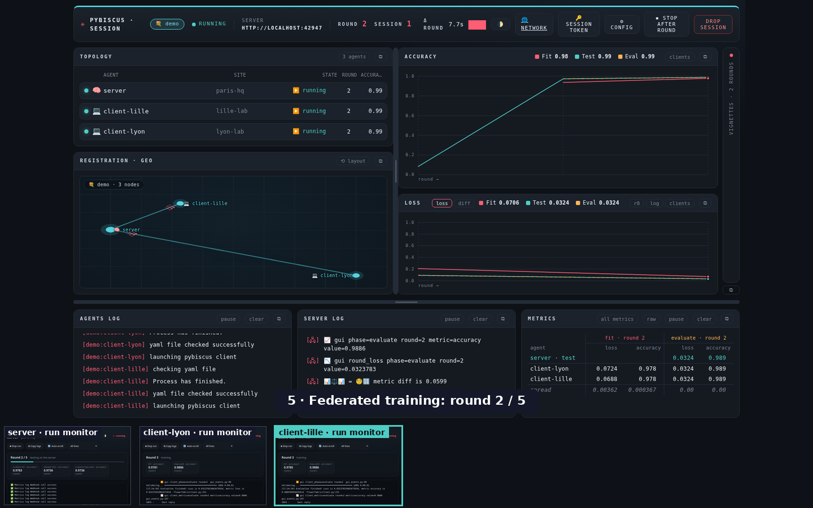

# Recording a session: rushes, videos and screenshots

`launch/doc/record_session.py` turns a session into a short video, for the documentation or a
presentation, and into the screenshots of the docs. It works in two times, as a film does:

1. **shoot**: the session runs and every page of it (the manager's, each agent's) is captured,
   with the events it goes through (an agent registers, a run is launched, round 3…). The result is
   a directory of **rushes**.
2. **edit**: a **cut** says what to make of the rushes: the scenes of a video (for each kind of
   event, the main view, an inset, a caption, a pace) and the screenshots to extract. Editing takes
   a few seconds and can be done again with another cut, without running the session again.

> This page follows the tool as it grows.

## Overview

Four kinds of things are involved: **processes** (the manager, the agents), **views** (one per
browser page), **events** (the moments of the story) and **rushes** (the directory where all of it
is recorded). The **cut** (the editing's YAML file) then designates all of these by name to make
the video.

### Two times, two layers

```
  scenario YAML ──► record_session.py ───────► rushes/ ──► cut YAML ──────► video, screenshots
                    (knows Pybiscus:           (images     (scenes by          (edit, or
                     what to start, which       + event     kind of event)      edit --ui)
                     pages, which moments)      log)
                          │
                          ▼
                    launch/doc/rushes/  (knows nothing of Pybiscus: captures named pages,
                                         notes events, composes)
```

- **`launch/doc/rushes/`** is generic: it captures the pages it is given by name, notes the events
  it is told about, then composes the video. Any web application can be shot with it
  ([Shooting another web application](#shooting-another-web-application)).
- **`launch/doc/record_session.py`** is the Pybiscus driver: it decides which processes to start,
  which pages to open, how to name them and which moments to signal.

### Four ways to shoot a session

| way | what drives the session |
|---|---|
| a **scenario** (`shoot <scenario>.yml`) | the tool: it starts a manager and its agents, registers them, configures and launches the session |
| a **hierarchical scenario** | the tool, for a tree of sessions (one manager per bouquet) |
| **`--attach <manager URL>`** | someone else: the tool only follows the manager's state |
| **`session_manager --record`** | someone else: the manager starts `--attach` on itself for each of its sessions |

### Processes

They come from the scenario (`launch/doc/scenarios/mnist-session.yml`: a `manager:` and its
`agents:`). Each is started under a name, `manager` or `agent_<name>`, with its log in `<name>.log`
in a neutral working directory (`/tmp/pybiscus-demo-XXXXXX`), on a **free port**, in its **own
process group**: at the end the tool stops them all by group, never looking processes up by name.
With `--attach` (and `--record`), nothing is started: the tool polls the manager.

### Views

One headless Chromium (driven by Playwright), one tab per page; each tab is declared as a **view**,
under a name `record_session.py` chooses:

| view | page |
|---|---|
| `manager` | the manager's page (hierarchical: `manager:core`, `manager:edge1`…) |
| `agent:<name>` | the successive pages of an agent, in one tab: registration, configuration form, run monitor |
| `session-form` | the server agent's session form |

- **Label**: computed again at each capture from the page's URL (`client-lyon · registration`,
  then `client-lyon · run monitor`); it is the text shown on an inset or a tile.
- **Panels**: at each capture, the position of a few elements is noted (manager: `geo`, `nodes`,
  `accChart`, `cyclesChart`; agent: `console`). A cut can then show a panel alone, written
  `view@panel` (`manager@geo`).
- **Focus**: the views at the centre of the action are captured at every tick (about 0.35 s), the
  others one tick in four. An image identical to the previous one is stored once.

### Events

An event is a moment of the story, a kind and fields: `{t, kind, ...fields}`. **The driver emits
them**, when it knows what happens; nothing is inferred from the images.

- **Scenario**: from the actions the tool performs itself.

  | kind | when | fields |
  |---|---|---|
  | `empty` | the manager is open, no agent | — |
  | `registered` | it fills an agent's registration form | `name`, `role`, `location` |
  | `configured` | the session form is open | `rounds` |
  | `started` | the session is launched from the manager | — |
  | `launched` | it checks and runs an agent's configuration | `name`, `role`, `location` |
  | `round` | the round number changes on the manager's page | `round`, `rounds`, `turn` |
  | `finished` | every run has ended | `accuracy` (read on the page), `rounds` |

  `turn` is a **storytelling choice**, not a measure: every client trains at every round, the tool
  just designates one in turn to show in the inset or as the outlined tile.
- **`--attach`**: from the changes of the manager's state (`/pybiscus-session/agents`): a new agent
  gives `registered`; an agent's state (`AgentState`) gives `validated`, `executing` or `failed`;
  the end gives `finished`, or `dropped`, `interrupted`, `lost`. A step shorter than a capture has
  no event.
- **Hierarchical**: the scenario lists its steps and their events (`relays`, `form`, `round`,
  `tab`…); it can also ask for **takes**, special named captures (a whole page, a panel after a
  click), kept in `takes/`.

### Rushes

```
rushes-mnist-session-20261019-172307/
  meta.json        window size, scale
  captures.jsonl   {t, view, file, url, label, panels}   one line per capture
  events.jsonl     {t, kind, ...fields}                  one line per event
  takes.jsonl      {t, name, file}                       the takes
  views/<view>/    the images
  takes/
```

`t` is counted in seconds from the start of the shooting: it is the axis of `edit --ui`'s timeline.

### Editing: everything is designated by name

```yaml
scenes:
  registered:                       # a kind of event starts a scene
    main: "agent:{name}"            # a view, filled with the event's fields
    inset: "manager@geo"            # view@panel
    caption: "Agent {name} registers ({role}, {location})"
  round:
    main: manager
    tiles: ["agent:*"]              # a pattern: every agent view
    highlight: "agent:{turn}"
overrides:
  - {kind: round, index: 2, side: bottom}           # "the 3rd round scene"
shots:
  - {file: x.png, view: manager, at: finished, after: 0.8, panel: accChart}
```

- A **scene** starts at each event whose kind has a rule, and lasts until the next one.
- The events' **fields** fill the `{…}`: `agent:{name}` designates the view of the agent
  registering, whatever its name in the scenario.
- A given scene is designated by its **kind and rank** (`kind`, `index`), a screenshot by an
  **event and an offset** (`at`, `after`): both stay valid when the same scenario is shot again.

### The fragile point

The names are a **convention between `record_session.py` and the cuts**: `manager`,
`agent:<name>`, the panels' elements, the kinds of events. Renaming an element of the manager's
page (`accChart`) breaks the cuts citing that panel; the editing then stops with a message listing
the panels available. Likewise, a cut writing a name literally (`agent:client-lille`) does not
follow a renaming in the scenario, unlike `agent:{name}`.

## Prerequisites

- `uv`, and the repository's environment (`uv sync`).
- **ffmpeg** on the `PATH`, with its H.264 and WebP encoders (Debian, Ubuntu:
  `sudo apt install ffmpeg`).
- The **Chromium of Playwright 1.63.0**: the script pins this version, whose browser is the one
  installed in `~/.cache/ms-playwright` (`chromium-1243`). If it is missing:

  ```bash
  uv run --with playwright==1.63.0 playwright install chromium
  ```

  The script declares its own dependencies (Playwright, requests, PyYAML, Pillow) in its header:
  `uv run` installs them in a separate environment, not in the project's.

## Shooting

From the repository root:

```bash
uv run launch/doc/record_session.py shoot launch/doc/scenarios/mnist-session.yml
```

A scenario naming its cut (`cut:`) is edited right after: this command gives the rushes and
`docs/videos/mnist-session.mp4`.

| option | effect |
|---|---|
| `--rushes <dir>` | directory of the rushes (default `experiments/recordings/rushes-<scenario>-<date>`); it must be empty |
| `--cut <file>` | cut to edit right after, instead of the scenario's; `--cut none`: no editing |
| `--output <path>` | basename of the video, or directory of the screenshots, instead of the cut's |
| `--attach <manager URL>` | follow a running session instead of a scenario (see below) |
| `--max-duration <s>` | with `--attach`: stop after this many seconds |
| `--agent-pages <n>` | with `--attach`: shoot the run monitor of the first `n` agents launching their run (default 4; 0: the manager's page only) |
| `--agent-token <name>=<token>` | with `--attach`: the access token of an agent beyond the loopback, to open its page (repeatable) |
| `--viewport <width>x<height>` | size of the captured pages, instead of the scenario's (`--viewport 1920x1080`) |
| `--scale <factor>` | pixel density of the captures (2: a 1440 × 900 page captured in 2880 × 1800, sharper text) |
| `--work-root <dir>` | where the working directory of the processes is created (default `/tmp`) |
| `--keep` | keep that working directory: logs of the manager and of each agent, run reports |
| `--tls-cert <crt> --tls-key <key> --tls-ca <ca>` | scenario: the managers and the agents serve HTTPS with this certificate (one valid for `localhost`, `certificates/gen_component_cert.sh`); the browser accepts this certificate's key only, without installing the CA ([multi-machine.md](multi-machine.md#encryption)) |

What happens with a scenario:
1. A working directory `/tmp/pybiscus-demo-XXXXXX` is created, with links to the plugin directories
   and to `datasets/`. The managers and the agents run there, so that their reports
   (`experiments/`) stay out of the repository. Its path appears in the server log shown by the
   pages: it is kept short and neutral on purpose, which is why `TMPDIR` is not used.
2. The managers, the agents and the Flower servers get free ports: the tool can run next to another
   Pybiscus installation, but **not next to a live session on the same machine** (it takes the CPU,
   the memory and, with `accelerator: auto`, the GPU).
3. A headless Chromium opens the pages, and the scenario plays the session as a person would. The
   pages being looked at (the manager's, and the one being acted on) are captured every
   `period`, the others every fourth time; an image identical to the previous one of its page is
   kept once.
4. When the runs have ended, the processes are stopped; the rushes stay.

A shooting fails, with a message, when an agent's configuration does not pass its check, when a run
does not succeed, or when the runs do not end within `timeout`.

**The rushes** (a directory; about 90 MB for the bundled scenario):

| file | content |
|---|---|
| `views/<view>/NNNNNN.png` | the captures of each page |
| `captures.jsonl` | one line per capture: time, view, file, the page's URL, its label, the position of its panels |
| `events.jsonl` | one line per event: time, kind and its fields (`{"t": 41.2, "kind": "launched", "name": "client-lyon", ...}`) |
| `takes/`, `takes.jsonl` | special captures asked by a scenario (a whole page, a panel after a click) |
| `meta.json` | viewport, scale, image size |
| `edit/` | the images composed by the last editing |

## Editing

```bash
uv run launch/doc/record_session.py edit <rushes> launch/doc/scenarios/mnist-session.cut.yml
uv run launch/doc/record_session.py edit <rushes> my.cut.yml --output docs/videos/try
```

### Editing interactively

```bash
uv run launch/doc/record_session.py edit <rushes> my.cut.yml --ui
```

opens a page of this machine only (`127.0.0.1`, a free port; `--port` to choose it, `--no-browser`
to only print its address):

- the **image** of the cut, as the export composes it, with ⏮ ◀ ▶ ▶| (or Home, ←, space, →): *play*
  shows each image of the video for its time, without the fade the export adds;
- the **video bar**: the scenes in the video's time, a click goes to one;
- the **timeline** of the rushes in their own time: the scenes (hatched when an override leaves one
  out), the events (large: they start a scene; small: no rule), and a track per view, a mark per
  capture (bright when the page changed). A click shows the cut's image at that moment, or on a
  view's track that view alone; a click on a scene selects it; the wheel zooms, a drag moves;
- the **scene** selected: its time in the rushes and in the video, its images, its main view, inset,
  tiles, outlined tile, caption, pace and the event's fields, in yellow what an override of that scene sets.



The scene's settings are changed in the page, for **this scene** (an override: also its `offset`,
`duration`, the inset's `corner` and `width`, the tiles' `side` and `slots`) or for **every** scene of its kind (the rule). Each
change is checked by computing the plan again: a refused one (an offset reversing two scenes, an
unknown view…) shows its message and changes nothing. ↺ removes an override's value; *Leave out
this scene* skips it, *Bring it back* on its hatched mark undoes it. Tiles are typed as a list
separated by commas (`agent:*, manager@geo`); given to a scene having an inset, they replace it.

**Screenshots** (`shots`): *Capture here* adds the view shown, whole or one of its panels, at the
moment shown (in the plan: the scene's main view at that image; on a view's track: that view), under
the file name proposed or typed; a take of the rushes is added under its name. The shot is written
from the event before that moment (`at`, `index`, `after`), so that it designates the same moment in
another shooting of the scenario. Each screenshot is listed with its image, renamed in place, removed
with ✕, and marked ◆ on the timeline; the directory (`shots_dir`) is set there too. A cut of
screenshots only, without scenes, opens as well: the page shows the views and the screenshots.



*Save* (or Ctrl+S) writes the cut's file with its comments and layout kept, the previous one in
`<cut>.bak`; *Revert* drops the unsaved changes. The header says whether the page is saved, has
unsaved changes, or the file changed on disk: saving then asks first.

**Export** writes the video and the screenshots as `edit` does with the saved cut: the same files,
byte for byte (it waits for the cut to be saved). The *Export* section sets the video's path
(`output`, relative to the directory the editor was started in) and its formats; a bar follows the
images, then the encodings. The files written are listed at the end, the video playable in the page;
a failed export says why.



Without unsaved changes, the page reads the cut's file every 2 seconds: edit it elsewhere, save, the
page follows. A wrong cut is shown with its message, and the last plan stays.

### The cut

```yaml
output: docs/videos/mnist-session         # .mp4 and .webp are added (default: <rushes>/video)
formats: [mp4, webp]                      # png: the composed images as well
inset: {width: 0.42, corner: bottom-right}
timing: {caption: 3.5, round_frame: 0.25, last_caption: 5, blend: 0.4}

scenes:
  registered:
    main: "agent:{name}"
    inset: "manager@geo"
    caption: "2 · Agent {name} registers ({role}, {location})"
  round:
    main: manager
    inset: "agent:{turn}@console"
    caption: "5 · Federated training: round {round} / {rounds}"
    pace: progress
  finished:
    main: manager
    caption: "6 · Session finished: test accuracy {accuracy} after {rounds} rounds"
    pace: final

shots_dir: docs/images
shots:
  - {file: hier_core_relays.png, view: "manager:core", at: relays}
  - {file: hier_cycles.png, take: core-cycles}
```

**Scenes.** Each kind of event having a rule in `scenes` starts a scene, which lasts until the next
such event; an event without a rule belongs to the scene in progress. A scene shows, for each
capture of its main view in that time:

| key | meaning |
|---|---|
| `main` | the view filling the image (required) |
| `inset` | a view shown in a corner, with a tab naming it; never enlarged, so that its text stays readable |
| `tiles` | instead of an inset, a **mosaic**: the main view smaller, and beside it one tile per view of the list (`*` matches several: `["agent:*"]`), in the order the views appeared, the main view left out; a view gets its tile once it has been captured. A pattern's panel (`"agent:*@console"`) is taken where the capture has it |
| `highlight` | the tile outlined, as `"agent:{turn}"`: the agent whose turn it is |
| `caption` | drawn at the bottom of the image (with tiles on the right: in the band under the main view) |
| `pace` | `event` (the scene lasts about `timing.caption` seconds), `progress` (its images scroll by: `timing.round_frame` each), `final` (`timing.last_caption`, then the last image stays) |

**Mosaic** (`mosaic:`, the cut's layout of the tiles): `side: right` (default) puts them in a
column on the right, `side: bottom` in a row at the bottom; `slots` is how many the column or the
row holds before the tiles shrink (default 4 on the right, 6 at the bottom). A tile has the image's
proportions, so that `slots` tiles fill the column or the row: the main view keeps the rest
(three quarters of the width with 4 slots). A tile's label is cut to its width.

```yaml
mosaic: {side: right, slots: 4}
scenes:
  round:
    main: manager
    tiles: ["agent:*"]                     # the server and each client, as they appear
    highlight: "agent:{turn}"
    caption: "5 · Federated training: round {round} / {rounds}"
    pace: progress
```

A scene has an inset or tiles, not both.

| `side: right` (default) | `side: bottom` |
|---|---|
|  |  |

**One scene** (`overrides:`): a rule applies to every scene of its kind; an override changes one,
the `index`-th scene of its kind (0 the first, in the order of the rushes):

```yaml
overrides:
  - {kind: configured, index: 0, duration: 6}          # lasts 6 seconds, whatever its pace
  - {kind: launched, index: 1, skip: true}             # left out, its time too
  - {kind: round, index: 0, offset: 1.5, inset: "agent:client-lille@console", corner: top-right, width: 0.35}
```

| key | meaning |
|---|---|
| `main`, `inset`, `caption`, `pace`, `tiles`, `highlight` | instead of the rule's (`inset: null`: no inset, `tiles: null`: no mosaic) |
| `offset` | seconds added to the scene's start (negative: earlier); the scene before ends there; scenes keep their order |
| `duration` | the scene's time in the video, shared by its images (at least one video frame each, 0.04 s) |
| `corner`, `width` | the inset's corner (`top-left`, `top-right`, `bottom-left`, `bottom-right`) and width, a share of the image's |
| `side`, `slots` | the mosaic's layout for this scene |
| `skip` | the scene is left out with its time; the scene before still ends where it began |

An unknown key, a kind without a rule, an index beyond the rushes' scenes or two overrides of one
scene stop the editing with a message.

`{field}` in a view or a caption is replaced by the event's field. The views:

| view | what it shows |
|---|---|
| `manager` (`manager:<bouquet>` in a hierarchical scenario) | a session manager's page |
| `agent:<name>` | the agent's tab: its registration form, its waiting page, its configuration form (check, launch), then its run monitor |
| `session-form` | the server's session form, while it is filled |
| `<view>@<panel>` | a panel of a view: `manager@geo` (the map), `manager@nodes` (the agents and their states), `manager@accChart` (the accuracy curves), `manager@cyclesChart` (the cycles), `agent:<name>@console` (the run's log) |

The events, and their fields:

| shot by | events |
|---|---|
| a scenario | `empty`; `registered`, `launched` (`name`, `role`, `location`); `configured` (`rounds`); `started`; `round` (`round`, `rounds`, `turn`: the client whose turn it is in the inset, one per round); `finished` (`accuracy`, `rounds`) |
| `--attach` | `attached` or `joined` (`count`: agents registered); `registered` (`name`, `role`, `location`); `started`; `validated`, `executing` (`name`); `round` (`round`, `rounds`, `of_rounds`: " / 5", or empty when unknown); `failed` (`name`, `state`); `finished` (`accuracy`); `dropped`; `interrupted`; `lost` (the manager no longer answers: the shooting stops, what it has is edited) |
| a hierarchical scenario | `registered`; `relays`; `session-form` (`bouquet`); `form` (`name`); `round` (`round`, `rounds`, `turn`: the lower bouquet whose turn it is); `end`; `tab` (`tab`) |

**Screenshots** (`shots`, written into `shots_dir`): `{file, take: <name>}` copies a take of the
rushes; `{file, view, at: <kind of event>, index, after, panel}` extracts the view as it was just
after the `index`-th event of that kind (default 0), `after` seconds later (default 0), or one of its
panels.

**Timing** (`timing:`, seconds)

| key | meaning | default |
|---|---|---|
| `caption` | time an `event` scene lasts, shared by its images | `3.5` |
| `last_caption` | the same, for a `final` scene | `5.0` |
| `min_frame` | shortest time of one image | `0.25` |
| `round_frame` | time of one image in a `progress` scene | `0.25` |
| `progress_max` | longest time of a `progress` scene, however many its images: a long wait is squeezed | `8.0` |
| `end_hold` | extra time on the last image | `2.5` |
| `webp_width` | width of the WebP, in pixels (the MP4 keeps the captures' size) | `1080` |
| `blend` | share of each image's time spent fading into the next one: `0` cuts from image to image; images fade only within a scene, a new scene starts on a cut | `0.4` |

The defaults give a 1-minute video for the bundled scenario; `timing: {caption: 2.2, round_frame: 0.12,
last_caption: 4, blend: 0}` a brisker 40-second one.

## Scenarios

### A simple session

`launch/doc/scenarios/mnist-session.yml` (one server, two clients, 5 rounds; about 2 minutes):

| key | meaning | default |
|---|---|---|
| `cut` | the cut edited right after the shooting | none |
| `viewport`, `scale` | size and pixel density of the pages | `1440 × 900`, `1` |
| `inset_viewport` | the window of an agent's tab once its run is launched, narrow so that its run monitor stays readable as an inset | `760 × 470` |
| `period` | pause between two captures, in seconds (the captures themselves take a few tenths) | `0.35` |
| `manager` | `bouquet` (the session's name), `location`, `geo` (`[latitude, longitude]`) | required |
| `agents` | `name`, `role` (`server` or `client`), `location`, `geo`; the first server holds the session | required |
| `organisation` | organisation declared by every agent | `pybiscus-demo` |
| `session.options` | options chosen in the server's session form, by their labels (`model: MNIST CNN`); `" "` selects an optional section (`num_rounds`, `data_partition`) | required |
| `session.values` | values of the form's fields; `num_rounds` is required | required |
| `plugin_manifests` | manifests given to the agents, relative to the repository | the bundled one |
| `agent_invitations` | `true`: the manager invites each agent (`session_manager invite --agent`), which starts with `--invitation`; `required`: the manager refuses the session token too (`--require-agent-invitation`), its page then opened with its administration token; needs `--tls-cert`, `--tls-key`, `--tls-ca` | none |
| `timeout` | seconds allowed for the runs, once launched | `1800` |

Each agent registers through its own registration form, then its tab follows it to its run
monitor. With 3 tabs, the bundled scenario takes about 6 GB of memory on top of the system's.

### A hierarchical session

`launch/doc/scenarios/hierarchical-core-edges.yml` runs the core and two edges of
[hierarchical-session.md](hierarchical-session.md); its cut writes the screenshots of its
walkthrough into `docs/images` (check them with `git diff` before committing).

| key | meaning |
|---|---|
| `kind` | `hierarchical` |
| `managers` | one entry per bouquet: `bouquet`, `location`, `geo`, and `upper` (the bouquet above; none for the root) |
| `agents` | `name`, `role`, `bouquet`; a relay has `relay_for: <lower bouquet>` and is designated in its manager's page |
| `session` | `options` and `values` of the root's session form |
| `lower_session` | `options` and `values` added to each lower level's form, on top of what its upper level imposes and locks |
| `plugin_manifests` | the relay and `upper_level_link` need the hierarchical plugins |
| `link_transport` | `directory` (default) or `manager`: given to the managers as `--link-transport` |
| `link_transports` | the transport of some links, by lower bouquet (`{north: manager, south: directory}`), chosen in their upper manager's page |
| `invitations` | `true`: each upper level invites its lower levels (`session_manager invite`), which start with `--invitation`; needs `--tls-cert`, `--tls-key`, `--tls-ca` |
| `machine` | the name of the machine in the network view (`--machine` of every manager; a manager may give its own `machine`): the real host name stays out of the captures |
| `viewport`, `form_viewport` | the managers' pages, the forms |
| `film` | the managers having a page, which a cut can show (default: all); fewer pages save memory on a large tree, and the root must be one |
| `takes` | `name`, `at` (`registered`, `relays`, `session-form:<bouquet>`, `form:<agent>`, `end`), `view` (with `@<panel>`), `full_page`, `tab` (a tab of the manager's middle panel to open first: `cycles`, `constraints`), `click_text` (an element to click first, by its text: a form's section, such as `Server strategy`), `path` (another page of the manager, opened for the take: `/pybiscus-session/network`) |

Its other cut, `hierarchical-core-edges.video.cut.yml`, makes a video of the same rushes: the tree
on the core's map, the relays, the session forms, the launches, then the rounds on the core's page
with, in the inset, the accuracy curve of the edge whose turn it is, and the cycles at the end:

```bash
uv run launch/doc/record_session.py edit <rushes> launch/doc/scenarios/hierarchical-core-edges.video.cut.yml
```

Its events add `round` (`round`, `rounds`, `turn`: the edge in the inset) and `tab` (`tab`: a tab
a take opened, the pages being captured after it). The agents register by the API (no tab each,
for memory) and their tab is closed once launched.
**Memory**: its 3 managers, 9 agents (6 mnist runs) and the browser reach about 15.5 GB on a 16 GB
machine; run it alone.

`launch/doc/scenarios/hierarchical-tree.yml` runs the tree of four sessions of the second experiment
(10 agents; `film: [core, south]`), and its cut writes the `hier3_*` screenshots.

## Outputs

- `<output>.mp4`: H.264, readable everywhere (about 2 MB for the bundled scenario at
  `1440 × 900`; at `1920 × 1080` with `scale: 2`, a 3840 × 2160 video about four times heavier
  per second).
- `<output>.webp`: animated WebP, `webp_width` wide (about 1.8 MB). Unlike an MP4 kept in the
  repository, GitHub shows it inside a page: ``.
- `<output>-frames/` (with `png`): the composed images.

**Choosing the size.** The manager's page follows the width of the window: below about 1200 pixels
its panels narrow and the logs become hard to read in a video. `1440 × 900` and `1920 × 1080` suit
it; `scale: 2` is for a large screen or a presentation.

`docs/videos/` is kept out of git for now (its `.gitignore`): every video weighs in the
repository's history forever, so only short ones should be versioned, once chosen.

## Shooting another web application

`launch/doc/rushes/` shoots any page Playwright opens. A driver declares its views
(`Shooting.add_view(name, page, panels, label)`), says which are in focus, signals its events and
ticks; a cut then edits the rushes as above. A view's **panels** are given as:

- an element's `id` (`"console"`): the element itself;
- `(name, CSS selector)`: the first element matching it;
- `(name, CSS selector, container)`: the closest ancestor of that element matching `container`,
  for a panel shown with its frame and title. Pybiscus' pages give `"section"`
  (`("geo", "#geo", "section")`).

`launch/doc/demos/editor_demo.py` is such a driver: it shoots `edit --ui` at work on the rushes
of the MNIST scenario (play, a caption changed, the round scenes put in mosaic, a scene left out
and brought back, a screenshot, save, export), with a cursor drawn in the page, a headless browser
showing none. Its cut is `launch/doc/demos/editor-demo.cut.yml`. It needs rushes of the MNIST
scenario, as the command of *Shooting* gives them (its scenes are clicked by kind and rank: the
second registration, the third round…):

```bash
uv run launch/doc/record_session.py shoot launch/doc/scenarios/mnist-session.yml   # if not done yet
uv run launch/doc/demos/editor_demo.py experiments/recordings/rushes-mnist-session-<date>
# docs/videos/edit-ui-demo.mp4, about 70 s
```

The editor is started from a neutral directory under `/tmp` (the export shows the paths it
writes), on a free port, in its own process group, stopped at the end.

### Having a driver written by a coding agent

Each application needs its own driver, but the driver follows a pattern: a coding agent that can
read this repository can write it. Give it the prompt below, its placeholders filled; it reads the
rushes package and the editor's driver, writes a driver and a cut, shoots, looks at the images and
corrects until the video tells the story.

```text
Write a driver that films a web application with the shooting tool of this repository, and the
cut that edits its rushes into a video.

The application: <WHAT IT IS>
How to start it: <COMMAND, PORT OR URL, DATA IT NEEDS, HOW TO STOP IT>
The story to film, step by step: <e.g. "an empty list; add three tasks; mark one done; filter the
done tasks; delete one">
Video: <LENGTH, e.g. about 60 s>, captions in <LANGUAGE>, written to <OUTPUT BASENAME, e.g.
docs/videos/my-app>.
Driver and cut: <e.g. launch/doc/demos/my_app_demo.py and launch/doc/demos/my-app.cut.yml>.

Read first:
- docs/recording.md, sections "Overview", "The cut" and "Shooting another web application";
- launch/doc/rushes/shooting.py (Shooting: add_view, set_focus, event, tick, capture, take;
  panel_spec) and the docstring of launch/doc/rushes/editing.py (the cut's keys);
- launch/doc/demos/editor_demo.py and launch/doc/demos/editor-demo.cut.yml: a complete driver of
  the same kind, to follow.

The driver:
- a script with a PEP 723 header (playwright==1.63.0, pyyaml, pillow, ruamel.yaml>=0.19.1), run by
  `uv run`, importing launch/doc/rushes (Shooting, edit, log) and nothing of Pybiscus;
- starts the application itself if it is local: a free port, its own process group
  (start_new_session=True), stopped by os.killpg in a finally; never look processes up by name;
- works in a directory with a neutral name under /tmp when the application shows paths;
- declares a view per page (a short name: "app", "admin"…), with panels for the parts a cut may
  show alone: an element's id, (name, CSS selector), or (name, CSS selector, container) to take
  the element with its frame and title;
- emits an event at the start of each step of the story, with fields the captions can use (a
  name, a count…), then acts and ticks: about 3 ticks to let a change be seen, more on a moment to
  dwell on;
- draws a cursor in the page (a headless browser shows none) that moves to what is clicked, and
  types text by a few letters per tick;
- choose an option of a <select> with select_option without clicking it (a click shows its native
  list over the page in the captures);
- if the page is taller than the window, scroll to what is used (smoothly) and back, as a person
  would; mind elements scrolling on their own (scrollIntoView also scrolls the window);
- after an action that reaches a server, wait for the page to be drawn again before the next one;
  before following a long operation, wait until it has really started.

The cut: one rule per kind of event (main view, caption, pace: progress plays the images about as
shot, event shows a step in about 3.5 s, final ends on a longer caption); timing to keep the pace
close to the shooting (round_frame 0.3); overrides to shorten a long wait (duration).

Validate:
1. shoot with the cut "none", read events.jsonl, and look at images taken at the key moments of
   each step (captures.jsonl gives each image's time): the cursor where expected, every action
   visible, nothing hidden under the fold or a popup;
2. correct the driver and shoot again until every step reads right;
3. edit, then look at frames taken in the middle of each scene of the video: each caption over the
   step it describes;
4. report the length of the video, its events, and what was corrected on the way.
```

## When something goes wrong

- **An agent's configuration does not pass its check**: shoot again with `--keep` and read
  `agent_<name>.log` in the working directory; check the scenario's `session.options` against the
  labels of the server's session form.
- **`Executable doesn't exist at …/chromium_headless_shell-…`**: the Playwright of the script does
  not match the installed Chromium; install the browser (see *Prerequisites*).
- **The runs do not end**: `timeout` is reached; with `--keep`, the agents' logs and the reports
  in `experiments/` tell where the run stopped.
- **`no capture of the view …` or `no panel …` when editing**: the cut names a view or a panel the
  rushes do not have; the message lists those they have.

## Recording a session you run yourself

**With `--attach`**, the tool follows a session driven by hand, from its manager:

```bash
uv run launch/doc/record_session.py shoot --attach http://localhost:5555 --output docs/videos/my-session
```

It drives nothing and starts nothing: it opens the manager's page in a headless browser, reads the
manager's state (`/pybiscus-session/agents`) between two captures, and turns what happens into
events. When an agent launches its run, its run monitor is opened too, at the address the agent
registered with, as the view `agent:<name>` (the first 4, `--agent-pages`): the cut shows them as
tiles beside the manager (`executing`, `round`, `failed`), the agent concerned outlined. An agent
beyond the loopback asks for its access token (`--agent-token <name>=<token>`); without it, or if
its address cannot be reached from the recorder's machine, its page is left out with a message and
the video shows the manager alone. It stops by itself when every launched run has ended (or when the session is dropped), at
`--max-duration`, or on **Ctrl+C**; the rushes are then edited with
`launch/doc/scenarios/attach.cut.yml`, unless `--cut` gives another cut.
It can be started before or during the session. Started during it, it shows only what happens from
then on (`joined` first), but the page still shows the whole session so far: it reads the logs, the
metrics and the vignettes from their beginning.

- Without `--output`, the video goes into the rushes (`<rushes>/video.mp4`). A scenario file can
  still be given, for its `viewport`, `scale`, `period` and `cut`.
- An agent going through a step faster than a capture (a few tenths of a second) gets no event for
  it: its next state's follows.
- A manager reachable beyond the loopback requires its administration token: give the URL it
  printed when it started, `--attach 'http://host:5555?token=…'`.
- The recorder's page and the pages of the people following the session do not take anything from
  each other: each page reads the manager's logs, metrics and vignettes from its own position.

**By the manager itself**, `session_manager --record [DIR]` films each of its sessions, with
`--attach` on its own page, into `DIR` (default `experiments/recordings`, from the manager's
directory): a `rushes-<bouquet>-<date>/` per session, its `video.mp4` and `video.webp` inside, and
the recorder's log beside it (`rushes-<bouquet>-<date>.log`). The manager's console says when a
recording starts and where its video is.

```bash
session_manager --port 5555 --bouquet demo --record
```

- A recording starts with the manager, then again whenever it is ready for a new session: after a
  *Drop session* (no agent registered), or when a session is launched while none records (it then
  joins it: *Recording joins the running session*). It ends with the session (its runs ended, or
  the session dropped). A repeated session is recorded until its first runs end.
- The recorder is `launch/doc/record_session.py`, run by `uv` in its own environment and process
  group: the manager needs a checkout of the repository, `uv`, `ffmpeg` and the Chromium of
  Playwright (see *Prerequisites*), but no new dependency. It refuses to start without them.
- When the manager is stopped (Ctrl+C), the recording ends there and its video is edited all the
  same, the recorder finishing on its own. A recorder that fails at its start (its log says why)
  stops the recording for the rest of the manager's run.
- It is given the manager's administration token through its environment, never in a command
  line. Agents beyond the loopback asking for their token are left out of the video (manager
  alone), as with `--attach` without `--agent-token`.
- A Chromium follows the session all along: a few hundred MB of memory, and a capture every 0.35 s.

**Asked for by the session form**: its `record` box films that session only, without `--record`.
The recording starts when the session is launched, so it shows the session from its start, not
the agents' registrations (*Recording joins the running session*); it goes into
`experiments/recordings` from the manager's directory. A manager whose machine cannot record (no
`uv`, `ffmpeg` or checkout of the repository) refuses the session, the reason under the box. A
manager started with `--record` films every session, the box checked or not.

**The video in the session's reports**: once a recording is edited, the manager copies its video
into the server's reports directory (the one the server's run announces, `experiments/<bouquet>/<date>`)
as `session-video.mp4` and `session-video.webp`, when that directory is on the manager's machine
(given as an absolute path); otherwise the video stays with its rushes, and the manager's console
says so. A recording ended by stopping the manager is not copied.

**In the manager's page**, a pill beside the round number follows the recording: **● REC** (blinking)
while the session is filmed, *REC · editing* while its video is made, then *🎬 video*, its tooltip
giving where the video is (*🎬 failed*: the recorder's log).

**The page's ⏺ record button** films from now on, whatever the session's state, without `--record`
nor the form's box: before the agents register, or a session already running (its video then
starts there). *⏹ stop recording* ends the recording going: its video is edited and copied into the
session's reports as above. With `--record`, the stop ends only that recording: the next session
launched, or the next one after a drop, is recorded again. The button is disabled, its tooltip
saying why, when the manager's machine cannot record, and while a video is being edited.

**With a screen recorder**, the session can also be recorded from your own screen:
[OBS Studio](https://obsproject.com/) (a *browser source* per page lets a scene show the manager
and agents side by side), or on Windows the Xbox Game Bar (`Win` + `Alt` + `R`). Captions and
time-lapse are then added while editing (Clipchamp, Shotcut, Kdenlive, ffmpeg).

