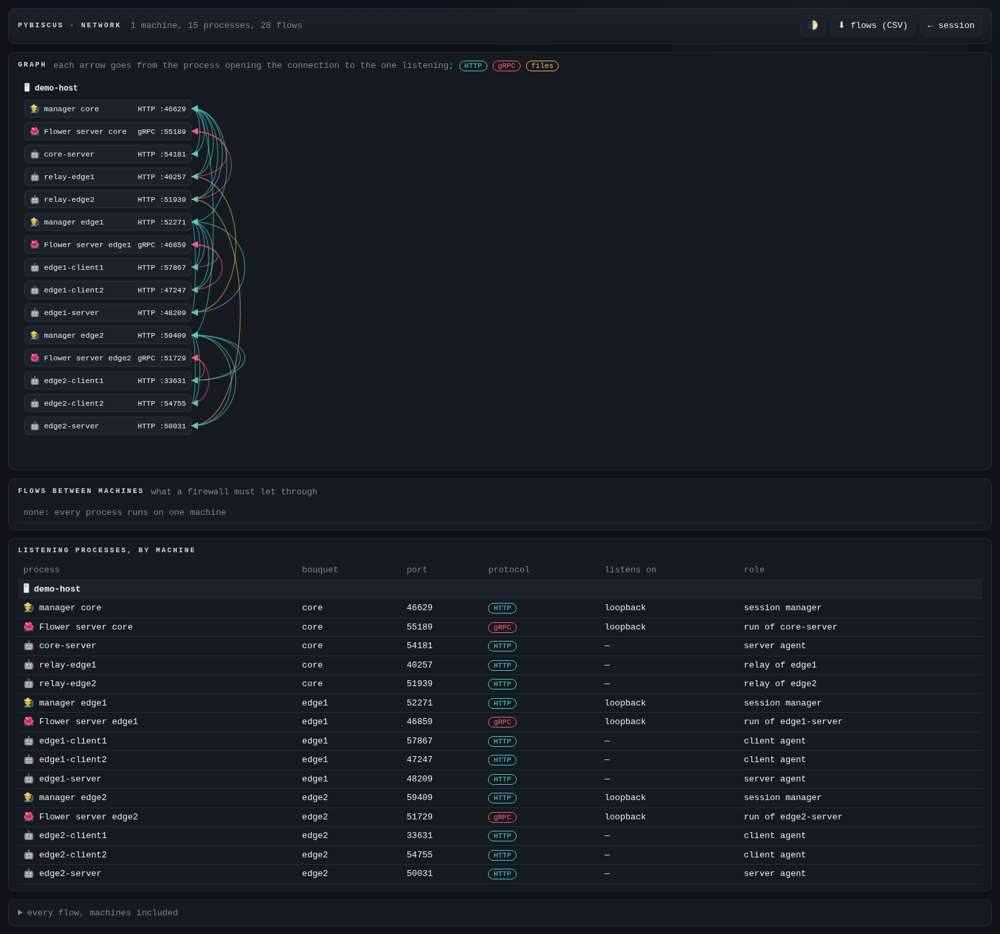
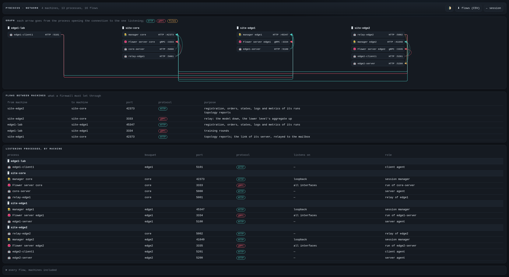
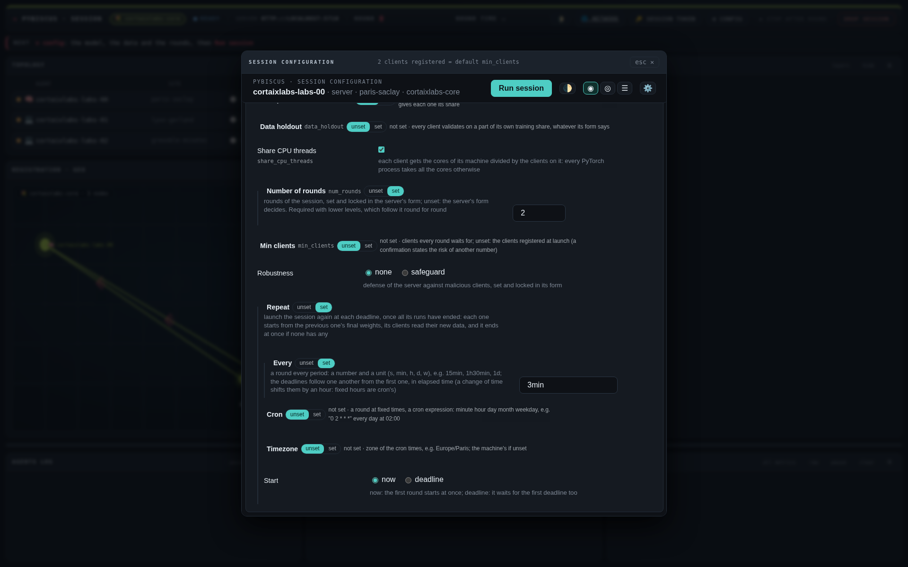
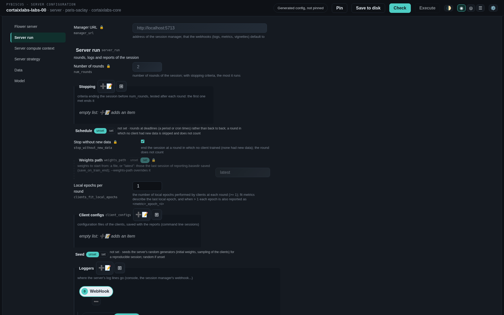
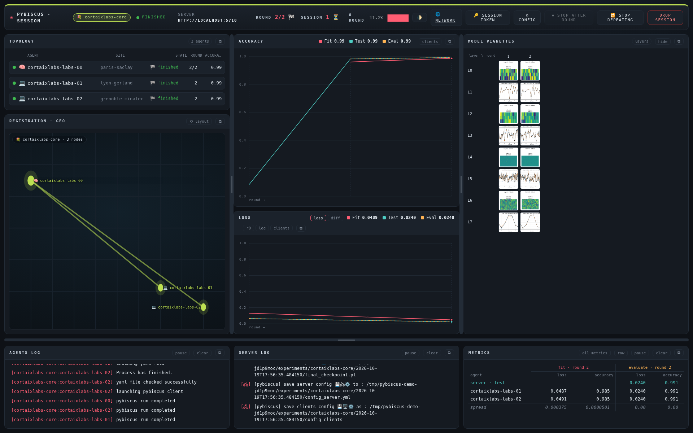

# Session using the manager

Install Pybiscus first ([Getting started](getting_started.md#installation)).

The session manager registers the agents of a session (one per site, see [Agent](agent.md)), sets
the parameters they share (model, data, how the data is shared, minimum number of clients,
robustness...) in their forms, locked, and follows the session: topology, charts, logs and metrics
of every participant in one page.

## Walkthrough

### 1. Start the manager

```bash
./launch/session/run_manager.sh
```

Open the URL it prints, `http://127.0.0.1:5555/pybiscus-session/manage` (with `?token=…` when it
requires one, see [Access tokens](#access-tokens)). The page is empty until agents register.
The script names the session's bouquet (`--bouquet cortaixlabs-core`), shown on the page's map;
without the option, the page shows the bouquets the agents declare at their registration. The
bouquet also titles the browser tab and gives the page a colour (band, pill and tab icon), derived
from its name, or given with `--color` (any CSS colour, e.g. `--color "#ff8800"`): the pages of
two managers open side by side are told apart at a glance.

With `--bouquet`, an agent declaring another bouquet is **refused** at its registration (HTTP 409,
with the bouquet expected): it has most likely been given the wrong manager's URL, which is easy to
do when several managers run. `--bouquet-mismatch warn` registers it anyway, with a warning in the
manager's log and in the agent's registration page. An agent declaring no bouquet gets the
manager's.

With `--record`, the manager films each of its sessions into a video (its page and the agents' run
monitors, with captions), in `experiments/recordings` or the directory given; the session form's
`record` box films one session only ([Session parameters](#session-parameters)), and the page's
**⏺ record** button films from the moment it is clicked until *⏹ stop recording*. A **● REC** pill
beside the round number shows it, and the video is copied into the session's reports: see
[recording.md](recording.md#recording-a-session-you-run-yourself).


### 2. Start the agents

One agent per site: the server's, then the clients'.

```bash
./launch/agent/cli/5000.sh
./launch/agent/cli/5001.sh
./launch/agent/cli/5002.sh
```

Each agent reports to the manager when it starts (agents log, bottom left); the topology lists
it, dimmed, with *register ↗* to its registration page, and the line under the top bar gives the
next step.


### 3. Register the agents

Open the registration page each agent prints, `http://127.0.0.1:500x/session/agent/registration`:
the manager's URL, the **session token** (proposed when the agent runs from the manager's
directory, otherwise copied from the manager's 🔑 *Session token* button), the agent's name,
its group (*bouquet*), location and role (*Server* for the agent 5000, *Client* for the others).
Once the manager's URL is given, the page asks the manager for its session's bouquet
(`/pybiscus-session/identity`): when it has one, the *Bouquet* field takes it, is locked and drawn in
the bouquet's colour, with a warning if the agent's `--config` names another one; otherwise (no
bouquet, manager not reached, token missing) the field stays free and the manager checks it at the
registration.
*Register agent* sends it to the manager; the agent then waits for the session to start.
(On one machine, [`3frames.html`](#all-the-agents-in-one-page) shows all the agents in one page.)


The registered agents appear in the manager's topology and on its map.

**Without a browser**: an agent started with `--register` (or `PYBISCUS_REGISTER=1`) registers
itself at its start, from its registration configuration (`--config`, see
`pybiscus_agent_registration_config/`) and its `--invitation` if it has one, as the page would: the
manager's bouquet when the file names none, its place, its machine. It registers again every 5 s
while the manager does not answer (started after the agents, restarting); a refusal (a name taken,
an invitation required) is in its log and is not retried. The session token is the file's
`session_token`, else `$PYBISCUS_SESSION_TOKEN`, else the token file of a manager of the same
machine started from the same directory. With [`--accept-launch`](#launched-by-order), no page of
the agent is ever needed:

```bash
pybiscus_agent --port 5001 --config agent_5001.yml --register --accept-launch --launch-config my-client.yml
```

### 4. Configure and run the session

The ⚙ *Config* button opens the session configuration. It is greyed out until the server agent
is registered (and, in a hierarchical session, until every lower level has its relay and the
upper-level session is configured: its tooltip says what is missing). Its header gives the number of clients registered. Choose the model with its
hyperparameters (set and locked in every agent's form; a dictionary field is left to each form) and the
data, and the optional session settings (described in [Session parameters](#session-parameters)):
how the training data is shared between the clients (`data_partition`), a validation set held out
of each share (`data_holdout`), `num_rounds`, `min_clients`, `robustness`, `share_cpu_threads`.


*Run session* sends these values to every agent: their forms open with them set and locked (🔒
on the field name). A session the manager refuses (a repetition's period or zone that it cannot
read, a lower level without a relay…) leaves the form open, each problem in red under its field, or
under the button when it is about no field.

### 5. Launch the server

The server's form opens with the session values locked: the strategy's `min_*_clients`, the
robustness decorator, the data and model choices and the partition fields. Its loggers and metrics
loggers default to the manager's webhook (`manager_url`, set and locked to this manager's
address), so its logs and metrics appear in the manager. Set the
other values (number of rounds, strategy, pipeline...), then *Check* and *Execute*.


### 6. Launch the clients

Each client's waiting page opens its form once the server runs, with the server's address and the
session values set: its own share of the data (`partition_id`, `num_partitions`, its `cid`), the
holdout, its number of CPU threads. *Check* and *Execute*.


Every agent's page then switches to its run monitor (state, live log, stop button).


### Launched by order

An agent started with `--accept-launch` (or `PYBISCUS_ACCEPT_LAUNCH=1`) needs neither its form nor
an open tab at the launch: when the session is launched, the manager orders it to launch its run.
The agent asks the manager for the session's presets, as its waiting page does, applies them to its
launch configuration as the form would, checks the result and starts the run; a failure (a check
refused, no presets) is in the manager's log.

```bash
pybiscus_agent --port 5001 --accept-launch --launch-config my-client.yml
```

- `--launch-config <file>` (or `PYBISCUS_LAUNCH_CONFIG`): the run's configuration the presets apply
  to, with this machine's own values (data paths, devices, threads...). Without it, the form's
  defaults. The presets impose the same as in the form: the options and values the session sets
  replace the file's, and the file's other values stay.
- The servers are launched first; the clients launched by order once every server listens (Flower's
  client does not retry), even a server its operator launches from its form.
- An agent registered after the launch is launched at its registration.
- The registration goes through the agent's page, whose waiting page then follows the run's monitor
  once the order started it, or through `--register` ([without a browser](#3-register-the-agents)).
  The manager's page marks such an agent *🚀 by order*.
- A session can mix both: the agents without `--accept-launch` are launched from their form.

Nobody reads the configuration before the run starts: start an agent with `--accept-launch` only
for a manager you would trust to fill its form. The values calling an interpolation resolver
(`${oc.env:…}`) are ignored, as in the form, and the agent's log lists the presets it applied.

### 7. Follow the session

The manager shows, live:
- in its top bar, the session's state: waiting (for agents), not ready, ready (to be configured),
  running, stopping, finished, stopped, failed (an agent failed or was given an invalid
  configuration); its tooltip gives the details; *round time*, the duration of the last round and
  bars for the last rounds' (from the `timediffcompute` decorator of the server's pipeline);
- once the session has ended, a summary under the top bar: finished or stopped (and why), the rounds
  run, the duration from round 1, the last values of the main metric and of the loss (server's test,
  clients' evaluation, training), and the server's reports directory, with *copy* (a path on the
  server agent's machine); × hides it until the next session ends;
- before the first round, the charts a line each and narrower, the topology taking the width; the
  map says that the sites appear as the agents register;
- under the top bar, the next step until the session runs: register a server agent, then the
  clients; choose the relays (or wait for the upper level); *⚙ config* and *Run session*; *Check*
  then *Execute* on the server's page, then on the clients';
- the topology, a table of the agents: role, name, site, state (registered, checking, checked,
  running, finished, failed, stopped, invalid config), the round and the last value of the main
  metric (the server's test, a client's evaluation on its data); under it, dimmed, the agents
  started with a registration configuration (`--config`, as `launch/agent/cli/500x.sh`) that have
  not registered yet, each with *register ↗* to its registration page; they ask the manager for
  its orders every 5 s, and those silent for 15 s are marked *not reachable* (stopped, or cut from
  the manager); the map of the sites;
- the main metric per round, its last 40 rounds: the clients' training and evaluation (the average of
  all the clients, weighted by their examples), the server's test; curves that coincide (evaluation
  and test when the clients validate on the official test set) are drawn in dashes of their colours
  in turn. *clients* adds each client's value around the average of one phase (*evaluate* by
  default, or *fit*): a point per client and the band from the lowest to the highest; the choice is
  kept by the browser. Past 12 clients, the points of the hovered round only, and a darker band
  from the first to the third quartile, where half of the clients are. Hovering the chart shows
  the nearest round: its averages and, with *clients*, each client's value, sorted (clients at the
  same value on one row); past 11 rows, the 5 highest, the median and the 5 lowest. The scale fits
  the values (*0–1* for the whole scale) and the axis numbers the rounds (every 2, 5, 10… rounds
  when they are many); round 0 (the server's test before any training, far below the trained
  rounds) is shown with *r0*; these choices are kept by the browser;
- the loss, in the same way (*loss* tab): the clients' training and evaluation averages, the
  server's test, *clients* for each client's loss (its choice apart from the main metric's); the
  round 0 shown with *r0*, a logarithmic scale with *log*, *0–1* for a loss below 1, each choice
  kept by the browser; *diff*
  shows the change of the clients' average evaluation loss from one round to the next (from the
  `metricdiffcompute` decorator of the server's pipeline), its last 40 rounds, with the same
  fitted scale and round numbers, and in a
  hierarchical session *cycles* and *constraints* follow;
- the vignettes of the model's layers per round (from the `VisualizeModelLayers` decorator of the
  server's pipeline), folded by default into a strip on the right that counts the rounds received
  (a dot when new ones came while folded): a click shows them, *hide* folds them again, and the
  charts take the width; the choice is kept by the browser, for this manager. Shown, the matrix
  follows the last round, unless you scrolled back to earlier ones; the layers and the rounds stay
  in sight when it scrolls;
- the agents' and the server's logs, each line with the time the manager received it (the date on
  hover); in the server's, the reports directory reads `…/<its last directory>` (the whole path on
  hover, and in the summary);
- the metrics, a table with one row per client (named from the cid the session gave it; a cid it
  did not give shows as `#…`) and one for the server's test: for training (fit) and evaluation, the
  loss and the main metric of the last round, *all metrics* adding the others; a value from an
  earlier round is greyed, its round in its tooltip; ▼ and ▲ mark the clients at the lowest and
  highest main metric of the last round (ties included, equal as displayed; no mark when all show the
  same figures, nor for a group of more than half the clients, then the norm); a *spread* row gives
  max − min of the clients for each column. *raw* shows the metrics as the server logs them
  (`fit_<metric>_<cid>`, `val_<metric>_<cid>`, `val_<metric>_glob`, built by
  `pybiscus.core.gui_events`).

With several screens, the ⧉ of a panel opens it alone in a window of its own (the same page with
`?panel=<name>`: `topology`, `geo`, `accuracy`, `loss`, `vignettes`, `agents-log`, `server-log`,
`metrics`), to put on another screen; the vignettes folded into their strip have their ⧉ under it.
The main page gives the panel's place to the others of its column or row (a column left empty goes,
the charts take the height when no log is left) and shows a *⧉ name* mark in its top bar: a click on
it, or closing the window, or its *⧉ dock* button, brings the panel back. A detached window shows the
session's name, state and round; the actions (config, stop, drop, the choice of the relays) stay in
the main page. The browser keeps which panels were detached, and where: the main page, opened again
without them, offers *⧉ reopen name* (a browser opens a window only on a click), ✕ to keep them all
in the page. A window reopens on the screen it was on only where the browser allows it; else on the
current screen, to move once.

The manager's pages are dark by default; the 🌓 button of the top bar switches to light. The browser
keeps the choice for each manager and its other open pages (network, detached panels) follow it;
`?theme=dark` or `?theme=light` in the URL forces a theme for that display without keeping it. The
config page of an agent shown in the manager takes the manager's theme.


*⏹ stop after round* ends the session after its current round: the server is sent `SIGUSR1`
(see [cli.md](cli.md)), finishes the round, disconnects the clients and writes its reports
(checkpoint, ONNX export) as at a normal end. The button reads *stopping after round k…* until the
server's last round is over; the round counter then shows `k/N ⏹` (`N/N 🏁` for a session that ran
all its rounds, the reason of the stop in its tooltip), the server agent is *stopped* (⏹️), the
clients *terminated* (🏁). In a hierarchical session, the button is the top level's: its lower
levels end after the same round ([hierarchical-session.md](hierarchical-session.md#ending-before-the-last-round));
a lower level's manager disables it.

A session launched again at each deadline shows its number (`SESSION n`) and a *🔁 stop repeating*
button ([below](#repeated-sessions)).

*Drop session* ends the session and empties the page, for a new one with the same agents (which
register again). The runs of its agents still going are stopped: while the session runs, it asks
first. Once the session has ended, it reads *⟲ new session*, no longer in red. In a hierarchical session, the
lower levels follow: a lower-level manager drops its own session (and stops its runs) as soon as it
learns that the upper level dropped its session or launched another one — within its 10 s
heartbeat —, and its page says so (*⚠ session dropped*); its operator launches it again. An upper
level out of reach changes nothing: it may come back.

### All the agents in one page

When testing a session on one machine, `3frames.html` (at the root of the repository, to open as a
file in the browser) shows the server agent and 1 to 9 client agents in one page, each on its
registration page: often handier than one tab per agent. Three layouts: grid (all side by side),
focus (one agent large, the others as live miniatures) and single. It expects the agents on
`localhost`, the server on port 5000 and the clients from 5001; its ⚙ panel or URL parameters
(`3frames.html?clients=3&mode=focus`) change that. Its labels are in French.

The URL picks the session, and each session's page keeps its own settings (layout, number of
clients), so that two sessions can be followed side by side:

| session | manager | page |
|---|---|---|
| `cortaixlabs-core` | `launch/session/run_manager.sh` (5555) | `3frames.html?server=5000&client=5001&clients=8&bouquet=cortaixlabs-core` |
| `cortaixlabs-edge1` | `launch/session/run_lower_level_manager.sh` (5556) | `3frames.html?server=5100&client=5101&clients=8&bouquet=cortaixlabs-edge1` |

With `bouquet`, the page takes the colour of its manager's page (tab icon, band, pill); add
`&color=…` when the manager was given `--color`.


## Bouquets of a hierarchical session

*Under development: the managers are linked, the topology shown, and the levels train together
through a link the managers set, and dropping a session is passed down. A full experiment, with its
deployment diagram and screenshots: [Hierarchical sessions: two experiments](hierarchical-session.md).*

The plugins of these sessions (the relay client, the link decorator) are kept apart, in
`pybiscus-plugins-hierarchical/`, so that they do not appear in a simple session's forms. The agents
with a hierarchical role add its manifest (`launch/agent/cli/5007.sh`, `5008.sh` for the relays,
`5100.sh` for a lower-level server):
`PYBISCUS_PLUGIN_CONF_PATH=pybiscus-plugins/plugins-conf.yml:pybiscus-plugins-hierarchical/plugins-conf.yml`.

A manager started with `--upper-url` (and `--bouquet`) reports its bouquet to the upper-level
manager: its agents, their roles, states and locations, and the lower levels reporting to it in
turn. `launch/session/run_lower_level_manager.sh` starts `cortaixlabs-edge1` this way, reporting to
the manager of `run_manager.sh` (`PYBISCUS_UPPER_MANAGER_URL` for another one).

The upper-level page then shows the tree of the bouquets in its topology (each lower level indented
under its parent, its manager's address in the tooltip of its bouquet), and the lower levels' agents on its map, in
their bouquet's colour. The managers are drawn too, as diamonds, each dotted to its session's
server; a dashed line joins each lower
level's manager to its parent's (supervision; the federated learning links are the solid stars
between a server and its clients). A manager is placed with `--geo LAT,LON` (and named with
`--location`), else next to its session's server; the scripts place both at Palaiseau. The
lower-level page shows its upper level at the top of its topology and of its map.

On the map of any manager's page, a node (or its label) can be moved with the mouse to pull apart
the agents registered at the same place; a double click puts it back, *⟲ layout* puts them all
back. The registered coordinates do not change: only this page's drawing, kept by the browser.

The session is configured from the top: a lower level's session waits for its upper level's.
Until the upper-level session is launched, the lower-level manager keeps its ⚙ *Config* button
greyed out, and refuses to launch. Then its form opens with the upper level's **model (with
its hyperparameters), data and number of rounds** set and locked (models exchanged between the levels must be the same, and
each lower round answers one upper round), the rest of the
session (data partition, holdout, `min_clients`, robustness...) being its own; the manager also
imposes them whatever the form sends, and they reach the forms of its agents. A level in the middle
passes them on to its own lower levels.

The upper level is often another organisation's: a lower-level manager takes **only** these from
it, and its link. It ignores any other field (a path, an interpolation `${…}` in a hyperparameter,
a link to another directory than the default or whose `link_id` would leave it), says so in its log
and in the tooltip of the upper level's *connected* chip, and applies the rest.

Each lower level reaches the upper-level session through a **relay**: a client of the upper
session that computes nothing and stands for the lower session. The upper-level manager designates
it in its topology, for each lower level, among all its registered clients (agents register as
ordinary clients). It refuses to launch the session until every lower level has one, and no longer
changes them once the session runs. A relay gets no share of the data, no holdout and no CPU
threads, but counts in the minimum number of clients (the Flower server waits for it); its form
opens with the relay client set and locked. The lower-level manager shows which client relays it,
and the upper-level map draws the link between a relay and the server of its lower level.

**The link between the levels.** The relay (`flower_client.alternate_client_class`, `name: relay`)
and the lower level's server decorator `upperlevellink` (last of its `server_strategy.pipeline`,
refused elsewhere) share a link: a `transport` (see below), a `link_id`, a `timeout` (seconds,
default 3600). The managers set it: at
each launch the upper-level manager makes one link per lower level, with a new `link_id`
(`<upper bouquet>-<lower bouquet>-<time>`: files of an earlier run are never taken), sets it and
the relay plugin, locked, in the relay's form, and passes it down; the lower-level manager sets it,
locked, in its server's form as `server_strategy.upper_level_link`, which adds the decorator last
to the pipeline. From the command line, set the same values on both ends. Both sessions have the
same model and number of rounds; round `r`:

1. the upper server sends its model to its clients, the relay among them: the relay publishes it
   on the link and waits;
2. the lower server, waiting for that model, trains its round `r` on it and publishes its aggregate
   with its number of examples and fit metrics;
3. the relay returns that aggregate as its own fit result, weighted by the lower level's examples.

**Two transports**, chosen by the upper-level manager for each of its links: in its page, beside
the relay of each lower level (`link: directory` / `link: manager`, fixed once the session runs),
else `--link-transport`, else `$PYBISCUS_LINK_TRANSPORT`, else `directory`. A tree may mix them:
each upper manager chooses for its own links.

- `directory` (default): files in a directory both ends reach (`directory`, default
  `/tmp/pybiscus-links`): the relay and the lower server run **on the same machine**.
- `manager`: the **mailbox of the upper-level manager**, over HTTP (`PUT`, `GET` that waits for the
  object, `DELETE` on `/pybiscus-session/link/<link_id>/...`), the two ends **on any machines**.
  Each end only talks to its own manager, with its own session's token: the relay, a client of the
  upper session, to the upper-level manager; the lower server to its level's manager, which relays
  to the upper one with the token it already has for `--upper-url`. The traffic thus goes from the
  lower levels up, the way they already report to their parent: no port to open towards a lower
  level, and no token in a configuration (the reports keep them). The managers set `manager_url`
  on both ends. A manager in the middle of a tree keeps the mailbox of its links to its lower
  levels and relays the one it received from above.
  The mailbox keeps each object in memory until it is taken, up to 1 GiB per model; the other
  requests to the manager and the agents are bounded at 16 MiB.

```bash
uv run session_manager --port 5595 --bouquet core --link-transport manager ...
```

The objects are kept in the upper-level manager's memory until read (an MNIST CNN: 1.6 MB a
model); measured on a core and two edges, a round lasts the same with both transports (15 s).

The lower server waits for the upper model of round 1 from its start: its round 0 evaluation is
that of the model both levels start from. The relay answers the federated evaluation as a failed
client (it holds no data; the lower level evaluates every model on its own), and a round the lower
level could not aggregate, or a `timeout`, as a failed fit: the upper round goes on without it.
Files are `.npz` + JSON, written atomically and read once; the relay empties its `link_id` at start.
The relay loads no data (its machine may not hold the training set): the `data` section of its
configuration, still required, is not read.

**Cycles.** In a hierarchical session, the *Loss · metric diff* panel gets a *cycles* tab: one row
per level, this session first, then its lower levels indented (all the depths), one bar per round
(the last 20, of equal width). This session's bar is its whole round; a lower level's is the share
of that round it worked on it, from the upper model's arrival to its aggregate's departure, in red
when it failed; the tooltip gives the seconds and the examples. It shows which site holds the upper
rounds back. Each manager reads these times from its own server's log lines as they arrive, and
sends only durations up with its topology (at the end of each round): the sites' clocks need not
agree.

**Constraints.** A third tab, *constraints*, checks each lower level (all the depths) against its
parent: whether its session runs (or was dropped), then for the model, its hyperparameters, the data
plugin, the number of rounds and the link, ✓ when it applies what its parent imposes, ✗ otherwise
(the tooltip gives both values). The managers impose these values: a ✗ means a level runs a session
launched before its parent's, or by hand. Each manager sends the state of its session (the
constraints it applies, its link, the links it made for its own lower levels) up with its topology.

Several sessions on one machine need one Flower server port each: the session form proposes one
per manager (port 3333 for the manager on 5555, 3334 for the one on 5556...), and a Flower server
refuses to start on a port another server already listens to (left at the same port, two
sessions' servers would silently share their clients).

Several sessions can run from one directory on one machine: each agent keeps its uploaded
configuration (`configs/uploaded/<port>/`), its pinned server configuration
(`.pybiscus-cache/html-config/server-pin-<port>.json`) and the client run configurations a server
agent collects (`experiments/config_clients/<port>/`) apart, and the manager proposes, without
locking it, a reports directory per bouquet to its server (`${root_dir}/experiments/<bouquet>`, hence
one `current` link per session).

The whole topology is sent when it changes; between two changes, the lower level only sends a
heartbeat every 10 s. Silent for 30 s, it is shown as unreachable; an upper-level manager restarted
gets the topology again at the next heartbeat. When the upper-level manager requires tokens, give
its session token with `--upper-token` (or `PYBISCUS_UPPER_TOKEN`); a manager started from the same
directory on the same machine finds it on its own.

### Invitations

With `--upper-token`, a lower level holds the upper level's session token, the one of every
participant: whoever holds it may report under any bouquet, and it can only be revoked for all. Between
organisations, the upper level **invites** each site instead: an invitation names the site's bouquet
and carries a token of its own, accepted until its expiry date or until it is revoked, and only on the
routes of a lower level (its reports, the mailbox of its own link). An invitation is for a manager in
HTTPS (`--tls-cert`, `--tls-key`): its token travels at each contact.

**The upper level invites**, while its manager runs or not, from its directory:

```bash
uv run session_manager invite --bouquet edge1            # --port of the manager (5555), --days (90)
uv run session_manager invitations                        # the invitations, active, expired or revoked
uv run session_manager revoke --bouquet edge1
```

or from the **📨 sites** page of its manager (a button of its top bar, in HTTPS), which also lists
the sites: invited and not come yet, present, gone silent, expired, revoked, and the ones refused
(a manager without invitation, or one reporting under an invited bouquet without its token). The
invitation is written to `invitations/issued/<its bouquet>_downto_<the site's>.yml` (and downloaded
by the page), readable by its owner only: it holds the token, which the manager does not keep (only
its digest), so a lost invitation is issued again, the former one then refused. It holds the upper
manager's URL (the one of its last start, else `--url`) and the session's CA certificate (its
`--tls-ca`, else `--ca`, default `certificates/ca/ca.crt`), which the site then trusts for this link.
`invitations/` is not committed (its `.gitignore`).

**The site starts its manager with it**, in place of `--bouquet`, `--upper-url` and `--upper-token`
(refused together):

```bash
uv run session_manager --port 5556 --invitation edge1.yml   # or $PYBISCUS_INVITATION
```

The scripts `launch/session/run_manager.sh` and `run_lower_level_manager.sh` use the invitation of
`invitations/received/` when there is one (one only). The manager warns when the file is readable
by others or the invitation is about to expire, shows *📨 invited until …* above its topology, and
the upper level's refusal (revoked, expired) in its *not reached* chip.

**An invited site's link goes through the upper manager's mailbox** (`link: manager`, fixed in the
upper level's topology): its token gives its relay no registration with the upper level, so the relay
is one of the upper level's own clients, on its side. Between the sites, only the lower manager then
reaches the upper one ([security.md](security.md#across-sites)).

Without an option, an upper level accepts both its invited sites and lower levels reporting with
its session token (never under an invited bouquet). Started with **`--require-invitation`** (or
`PYBISCUS_REQUIRE_INVITATION=1`), it refuses every lower level without an invitation, from its
start; the option requires the tokens, on the loopback too. It concerns its own lower levels only:
a manager in the middle of a tree may run with both `--invitation` and `--require-invitation`.
Each manager may invite its own agents too ([Agents' invitations](#agents-invitations)).

## Network view

The **🌐 network** button of the manager's page opens `/pybiscus-session/network`: the session seen
as a system administrator sees it.

- **A graph of the machines**, each with the processes listening on it: the session manager
  (HTTP), the agents (HTTP), the Flower server of the session (gRPC, once the session is
  configured). Each arrow goes from the process opening the connection to the one listening:
  an agent's registration, its questions for orders, its states and its runs' logs and metrics to
  the manager (the manager calls no agent); the training rounds of the clients to the Flower server; a
  lower manager's reports to its parent; the links between the levels (the mailbox over HTTP, or a
  shared directory). Hover an arrow or a process for its purpose.
- **The flows between machines**: from which machine to which machine, port and protocol, what a
  firewall must let through; **⬇ flows (CSV)** downloads them (`/pybiscus-session/network.csv`).
- **The listening processes, by machine**: port, protocol, the address they listen on, their role.
- **Problems**: a link through a shared directory whose relay and server are on two machines.

An agent's machine is the name it gives at its registration; without one, the host of its address,
the loopback meaning the manager's own machine. Each manager sees its own session, its lower levels
(each lower manager reports its part with its topology) and, from outside, its parent: **the whole
session is seen at the head manager only**. On a single machine, the graph shows one machine with
all the ports; it is meant for sessions spread over several (`/pybiscus-session/network.json` gives
the same view as data).



On several machines (an illustration: the agents register under simulated machine names, the
managers are started with `--machine`, `launch/doc/network_sites.py`), the relay of `edge1` uses
the core manager's mailbox and stays on the core's machine, the relay of `edge2` shares a directory
with its server, and the flows between machines list what each site must let through:



`--machine` names a manager's machine in this view (default: its host name), and the agents it
reaches at the loopback.

## Session parameters

The session configuration (server agent) has an optional `data_partition` block: when set, the
manager shares the training data between the clients registered when the session is launched, each
client getting its `partition_id` (its rank) and the number of partitions, locked in its form, along
with a stable `cid` equal to that rank.

Its optional `data_holdout` block (`fraction`, `seed`) makes every client validate on examples
held out of its own training share: the manager sets and locks `val.source: holdout`, `val.fraction`
and `val.seed` in each client's form, late clients included (data plugins with a holdout: cifar,
mnist, hdfs; turbofan validates on its own engines and ignores it).

The manager also sets and locks the server strategy's `min_fit_clients`, `min_evaluate_clients`
and `min_available_clients`: every round waits for that many clients (Flower's default of 2 let a
session of 7 clients start with the first 2 to connect, and the robust aggregations size their
defense on that number). By default it is the number of clients registered at launch, shown in the
header of the session configuration; a client that leaves the session then stalls the next round
(Flower waits up to 24 h). The optional `min_clients` field of the session form sets another
number, and the manager asks for a confirmation stating the risk when it differs from the clients
registered:
- fewer: rounds start as soon as that many clients are connected, possibly without the others,
  and a robust aggregation sizes its defense on fewer clients; in exchange, the others may leave;
- more: the first round waits for the missing clients, and clients registered after the launch get
  no share of the data partition.

Its optional `num_rounds` is set and locked in the server's form; unset, the server's form decides.
A session with lower levels must set it (the manager refuses to launch otherwise): they follow it
round for round.

Its `robustness` choice (`none` by default, or `safeguard`) is set and locked in the server's form:
`safeguard` adds a defense against malicious clients to the server's pipeline (see
[Robust aggregation](robust-aggregation.md#the-robustness-setting)).

These session values are set in every option of the forms that has the field, not only in the
selected one: switching the strategy or the data plugin afterwards keeps them.

Its `share_cpu_threads` setting (on by default) shares the CPU of each machine between the clients
running on it: each agent tells the manager its machine and number of physical cores when it
registers, and each client gets `client_compute_context.num_threads` = cores / clients on its
machine (still editable in its form). The server gets none, since it never computes at the same
time as the clients; with several sessions on one machine, set `server_compute_context.num_threads`
by hand (see [CPU threads](configuration.md#cpu-threads)). Without it, every PyTorch client takes all the cores: three
cifar10 clients on a 14-core machine took 233 s per round instead of 20 s.

Its `record` box (off by default) has the manager film the session into a video, copied into the
server's reports as `session-video.mp4`: the manager's machine needs `uv`, `ffmpeg` and the
Chromium of Playwright, or it refuses the session (see
[recording.md](recording.md#recording-a-session-you-run-yourself)).

## Repeated sessions

The optional `repeat` block of the session configuration (`every` or `cron`, `timezone`, as
`server_run.schedule`, [configuration.md](configuration.md#rounds-at-fixed-times)) has the manager
launch the session again at each deadline, rather than run all the rounds in one long session: a
deadline is a new session of fresh processes, with no connection kept open in between.



- The operator checks and launches the first session as any other; its launch is the first
  deadline. Once all the runs of a session have ended, the manager waits for the next deadline,
  then has each agent run its last configuration again: the server first, the clients once it
  listens (Flower's client does not retry: started sooner, it fails at once). A deadline missed,
  the session having lasted longer than the period, is not made up for.
- The manager sets and locks in the server's form `server_run.weights_path: latest`, so that each
  session starts from the final weights of the previous one, `save_on_train_end`, which writes
  them, and `server_run.stop_without_new_data: true`. The clients read their data at their start;
  with an incremental data module (`hdfs`, `train.lots: new`), only what is new since the
  previous session ([configuration.md](configuration.md#data-arriving-between-rounds)).
  A session where no client has new data ends at once, its round not counted.

  

- The manager's page shows the number of the session (`SESSION 3`, followed by `⏳` between two
  sessions; the period and the next deadline in its tooltip). *⏹ stop after round* and the
  stopping criteria end the current session only: *🔁 stop repeating* lets it end and launches no
  other one; the drop ends both.

  

- A run that fails (a client leaving a round for lack of new data is not a failure) stops the
  repetition (`💥`): a defect would otherwise come back at each deadline unnoticed.
- A hierarchical session refuses `repeat`: its lower levels follow the rounds of the upper one.

## Access

The manager listens on 127.0.0.1 by default. When agents run on other hosts (they send it their
registration and logs), start it with `--host 0.0.0.0` (or a given address), e.g.
`launch/session/run_manager.sh --host 0.0.0.0`. For a session spread over several machines, see
[multi-machine.md](multi-machine.md). The manager and the agents serve HTTPS with `--tls-cert` and
`--tls-key`, and trust the session's CA with `--tls-ca` ([Encryption](multi-machine.md#encryption)).

### Access tokens

The other protections and the known limits: [security.md](security.md).

A component listening beyond the loopback (`--host 0.0.0.0` or an address) requires tokens:
whoever reaches a port opened to the network must not drive the session nor launch runs. On
127.0.0.1 (the default), it requires none, unless started with `--require-token` (a machine shared
with other users). Each component decides for itself: a client agent on 127.0.0.1 requires no
token, while the manager and the server agent it registers with, listening on the network, do.
It prints at start either `🔑 … open …?token=…`, or `🔓 … no token required`.
Without tokens, a component answers only the requests naming the loopback (`localhost`, `127.x`,
`::1`): a page of another site whose name points to 127.0.0.1 would otherwise be the same origin
as the component for the browser. Reached under another name (a reverse proxy), it refuses with
the advice to start it with `--require-token`.

The values the manager sets in the agents' forms may hold a reference to another field
(`${root_dir}/…`), not an interpolation calling a resolver (`${oc.env:NAME}`…): resolved on the
agent's machine, it would read it. The manager refuses one in its session form, under the field;
an agent ignores one it receives, leaves the field free and says so under it and in its log.

- **Access token of a component**: the manager and each agent have their own, for their pages and
  actions. Each prints, when it starts, the URL to open (`…?token=…`); the browser then keeps it in a
  cookie, and the page asks for it otherwise. The manager's is its administration token (launch or
  drop the session, follow it).
- **Session token**: the manager's, given to the participants (created even when the manager
  requires none, since a server agent listening on the network requires it from the others). An agent gives it at its
  registration (field *Session token* of its registration page, copied from the manager's
  🔑 button); it then presents it to the manager (registration, session parameters, logs) and passes
  it to the runs it launches (webhooks). It does not open the manager's pages.
- **Call token of an agent**: made by the agent at its start and given to the manager at its
  registration. The agent presents it when it asks the manager for its orders and posts a client's
  run configuration (the session token alone, held by every participant, would let any of them take
  another one's orders or post a configuration in its name); the manager's page opens the server
  agent's session form with it.

**Orders.** The manager calls no agent: each agent asks it for its orders
(`/pybiscus-session/orders`), every second during a session, every 5 s otherwise, and posts their
results. The orders are the stop of a run (*Drop session*), its stop after the current round, the
relaunch of a repeated session, the probe of the server's port before its clients are relaunched,
a client's run configuration for the server agent, kept in the server's reports, and the launch of
the run of an agent started with `--accept-launch` ([Launched by order](#launched-by-order)). An agent may
thus sit behind a NAT, or listen on its loopback only.

A token is kept, readable by its owner only, in `.pybiscus-cache/tokens/` of the directory where
the component was started: a restart keeps it (the browsers stay logged in). Delete the file to get
a new one, or give it:

| component | option | environment variable | file |
|---|---|---|---|
| manager (administration) | `--admin-token` | `PYBISCUS_MANAGER_TOKEN` | `manager-<port>-admin` |
| manager (session) | `--session-token` | `PYBISCUS_SESSION_TOKEN` | `manager-<port>-session` |
| agent | `--token` | `PYBISCUS_AGENT_TOKEN` | `agent-<port>` |

On the manager's machine, the agents and the runs started from the same directory find the session
token in its file: the registration page proposes it, and the webhooks of a run launched by hand
present it. Elsewhere, give it at the registration, or through `PYBISCUS_SESSION_TOKEN` (a run
launched by hand whose webhooks target the manager, or the `session_token` key of an agent's
registration configuration).

A scripted call presents the token as `Authorization: Bearer <token>` (see below).

Without TLS, the tokens travel in clear between machines: see [multi-machine.md](multi-machine.md).

### Agents' invitations

Whoever holds the session token registers under any name and role not taken yet, and posts logs and
states in the name of any agent. The manager may **invite** each agent instead: an invitation names
the agent and its role, and carries a token of its own, accepted until its expiry date or until it
is revoked; the agent and its runs present it in place of the session token. An invitation is for a
manager in HTTPS (`--tls-cert`, `--tls-key`). The same model as the [sites'](#invitations), from the
manager's directory, while it runs or not:

```bash
uv run session_manager invite --agent cortaix-labs-01 --role client   # --port (5555), --days (90)
uv run session_manager invitations                                     # the sites' and the agents'
uv run session_manager revoke --agent cortaix-labs-01
```

or from the **🎫 participants** page of the manager (a button of its top bar, in HTTPS), which also
lists its agents: invited and not registered yet, registered with their invitation, expired,
revoked, registered with the session token, and the registrations refused (an agent without
invitation, or one taking an invited name without its token, kept on its row until cleared). The
invitation is written to `invitations/issued/<the manager's bouquet>_agent_<the agent's name>.yml`
(and downloaded by the page), readable by its owner only; it holds the manager's URL and the
session's CA certificate, which the agent then trusts.

**The agent starts with it**, `pybiscus_agent --invitation <file>` (or `$PYBISCUS_AGENT_INVITATION`),
next to its `--config`: the invitation gives the manager's URL, the agent's name, role and token, and
prevails over the registration configuration, a default often copied from another agent's; the agent
warns at start, and its registration page shows, what they contradict. The registration page shows
*🎫 Invited by the manager until …*, these fields locked; the agent's address, site, organisation and
coordinates stay its own. The scripts `launch/agent/cli/<port>.sh` look in `invitations/received/`
(`launch/agent/received_agent_invitation.sh`): the file named after the agent and bouquet of the
configuration, else the only agent invitation there, its name then prevailing; several and none
named after it, they stop rather than choose.

The manager accepts an invitation's token for its own agent only: its registration under its name
and role, its session parameters, its states, its runs' logs, metrics and vignettes and, for a
relay, the mailbox of the link it relays. An invited name is never registered with the session token.
Without an option, the manager accepts both its invited agents and agents registering with the
session token. Started with **`--require-agent-invitation`** (or `PYBISCUS_REQUIRE_AGENT_INVITATION=1`),
it refuses every agent without an invitation and the session token on the agents' routes (a lower
level's manager still reports with it, unless `--require-invitation`); the option requires the tokens,
on the loopback too. In a hierarchical session, each manager invites its own agents, the relays of
its lower levels included, since they are its clients.

### Requests from other sites

A page of another site open in the operator's browser must not drive the agents or the manager.
Every request that changes something (POST, PUT, PATCH, DELETE) must therefore carry the header
`X-Pybiscus: 1`, otherwise it is refused with a 403; the actions (registration, session run, run of
an agent) are never triggered by a GET. Pybiscus' pages and components add the header; a scripted
call must add it too, with the agent's token when it requires one, e.g. (see `launch/agent/mngt/*.sh`):

```bash
TOKEN=$(cat .pybiscus-cache/tokens/agent-5000)
curl -X POST -H "X-Pybiscus: 1" -H "Authorization: Bearer $TOKEN" http://localhost:5000/server/config -F file=@server.yml
curl -X POST -H "X-Pybiscus: 1" -H "Authorization: Bearer $TOKEN" http://localhost:5000/server
```

The registration page of an agent calls the manager from the agent's origin: the manager accepts
such cross-origin calls from local origins (`localhost`, `127.0.0.1`, `[::1]`, any port) only. When
agents are opened from other hosts, allow their origins, one option per origin:

```bash
launch/session/run_manager.sh --host 0.0.0.0 --allow-origin http://site-a.example:5001
```

The header protects against other sites; the tokens (above) against whoever reaches the ports.
