# Session using the manager

Install Pybiscus first ([Getting started](getting_started.md#installation)).

The session manager registers the agents of a session (one per site, see [Agent](agent.md)), sets
the parameters they share (model, data, how the data is shared, minimum number of clients,
robustness...) in their forms, locked, and follows the session: topology, charts, logs and metrics
of every participant in one page.

## Walkthrough

### 1. Start the manager

```bash
./launch/session/run_manager.sh
```

Open the URL it prints, `http://127.0.0.1:5555/pybiscus-session/manage` (with `?token=…` when it
requires one, see [Access tokens](#access-tokens)). The page is empty until agents register.
The script names the session's bouquet (`--bouquet cortaixlabs-core`), shown on the page's map;
without the option, the page shows the bouquets the agents declare at their registration. The
bouquet also titles the browser tab and gives the page a colour (band, pill and tab icon), derived
from its name, or given with `--color` (any CSS colour, e.g. `--color "#ff8800"`): the pages of
two managers open side by side are told apart at a glance.

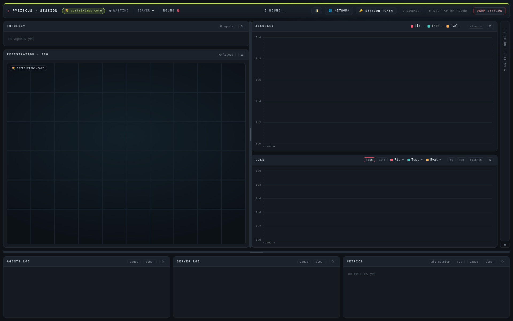

### 2. Start the agents

One agent per site: the server's, then the clients'.

```bash
./launch/agent/cli/5000.sh
./launch/agent/cli/5001.sh
./launch/agent/cli/5002.sh
```

Each agent reports to the manager when it starts (agents log, bottom left).

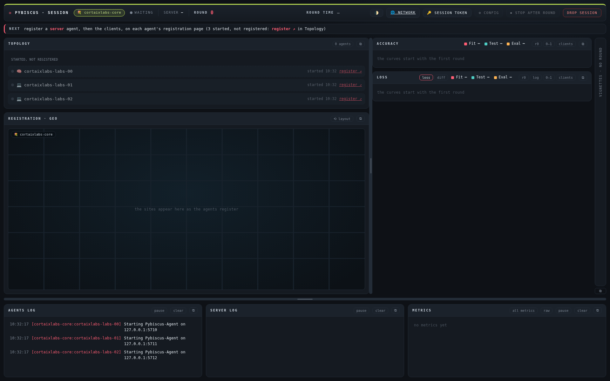

### 3. Register the agents

Open the registration page each agent prints, `http://127.0.0.1:500x/session/agent/registration`:
the manager's URL, the **session token** (proposed when the agent runs from the manager's
directory, otherwise copied from the manager's 🔑 *Session token* button), the agent's name,
its group (*bouquet*), location and role (*Server* for the agent 5000, *Client* for the others).
*Register agent* sends it to the manager; the agent then waits for the session to start.
(On one machine, [`3frames.html`](#all-the-agents-in-one-page) shows all the agents in one page.)

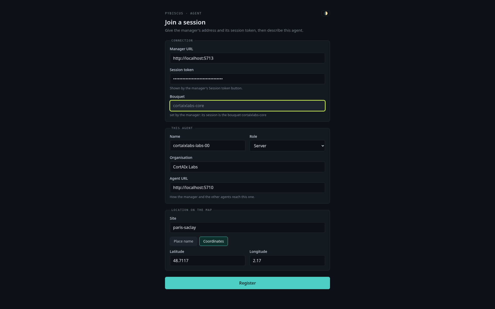

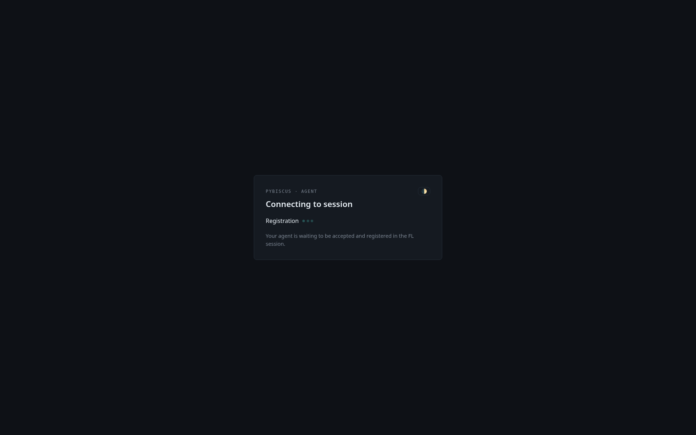

The registered agents appear in the manager's topology and on its map.

### 4. Configure and run the session

The ⚙ *Config* button opens the session configuration. It is greyed out until the server agent
is registered (and, in a hierarchical session, until every lower level has its relay and the
upper-level session is configured: its tooltip says what is missing). Its header gives the number of clients registered. Choose the model with its
hyperparameters (set and locked in every agent's form; a dictionary field is left to each form) and the
data, and the optional session settings (described in [Session parameters](#session-parameters)):
how the training data is shared between the clients (`data_partition`), a validation set held out
of each share (`data_holdout`), `num_rounds`, `min_clients`, `robustness`, `share_cpu_threads`.

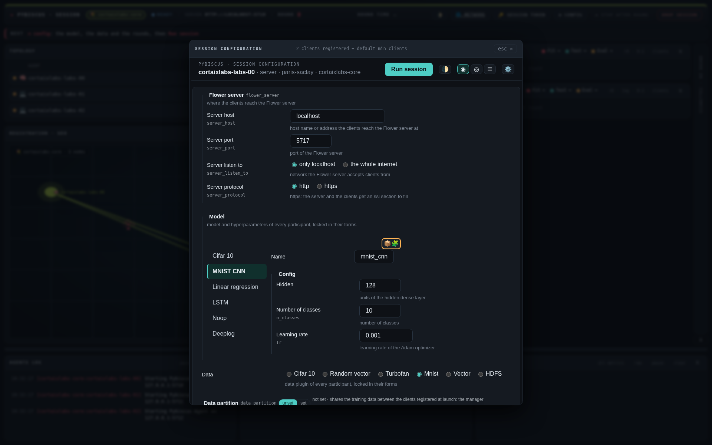

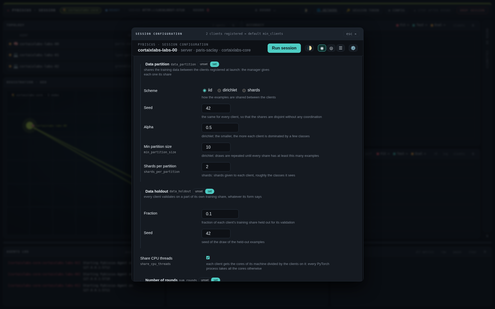

*Run session* sends these values to every agent: their forms open with them set and locked (🔒
on the field name).

### 5. Launch the server

The server's form opens with the session values locked: the strategy's `min_*_clients`, the
robustness decorator, the data and model choices and the partition fields. Its loggers and metrics
loggers default to the manager's webhook (`manager_url`, set and locked to this manager's
address), so its logs and metrics appear in the manager. Set the
other values (number of rounds, strategy, pipeline...), then *Check Config* and *Execute Config*.

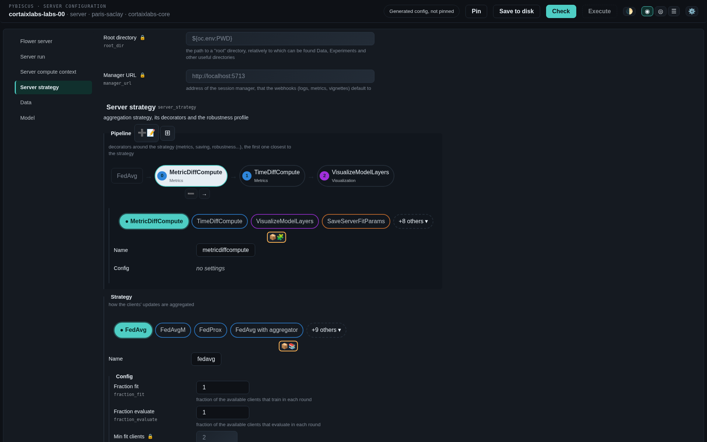

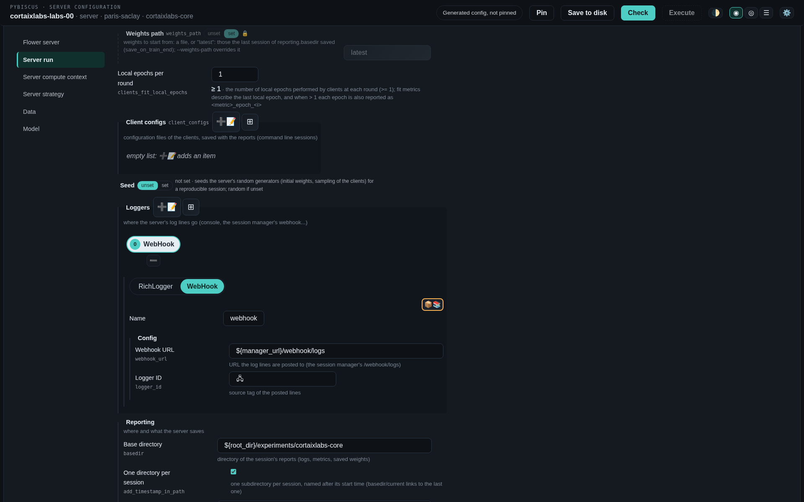

### 6. Launch the clients

Each client's waiting page opens its form once the server runs, with the server's address and the
session values set: its own share of the data (`partition_id`, `num_partitions`, its `cid`), the
holdout, its number of CPU threads. *Check Config* and *Execute Config*.

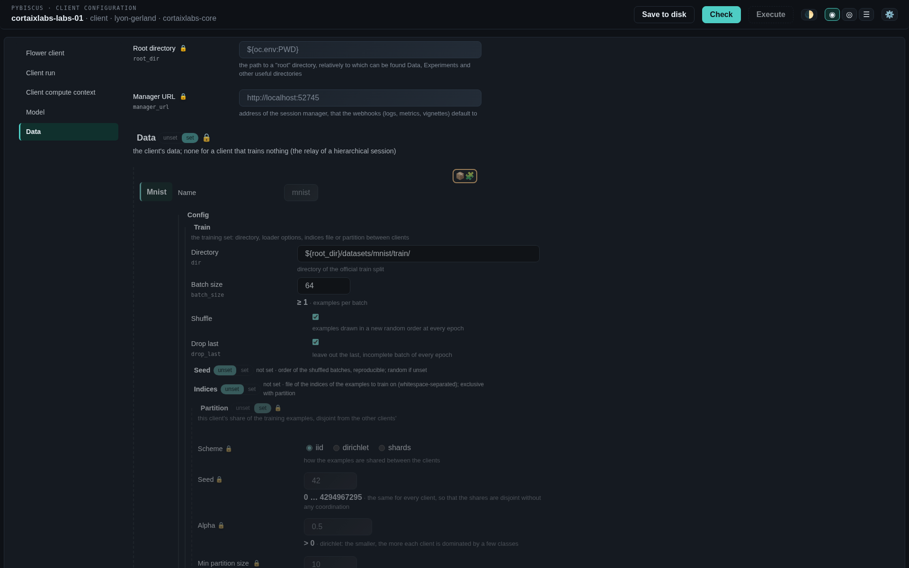

Every agent's page then switches to its run monitor (state, live log, stop button).

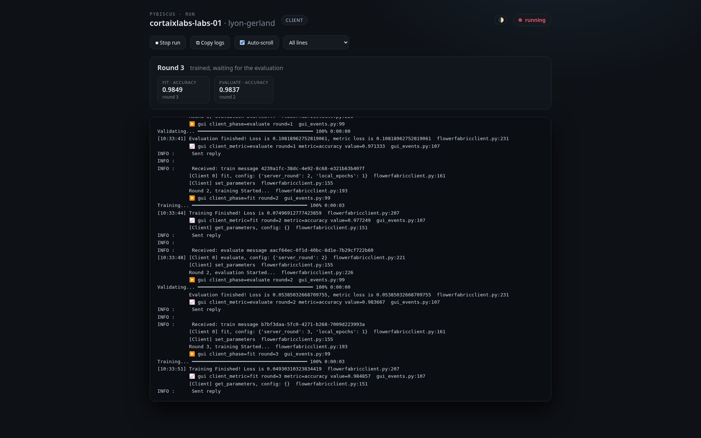

### 7. Follow the session

The manager shows, live:
- the topology (each agent's state, a 🏁 once its run has finished) and the map of the sites;
- the accuracy per round (clients' training, server's test, clients' evaluation) and the loss;
- the vignettes of the model's layers per round (from the `VisualizeModelLayers` decorator of the
  server's pipeline);
- the agents' and the server's logs, and the metrics.

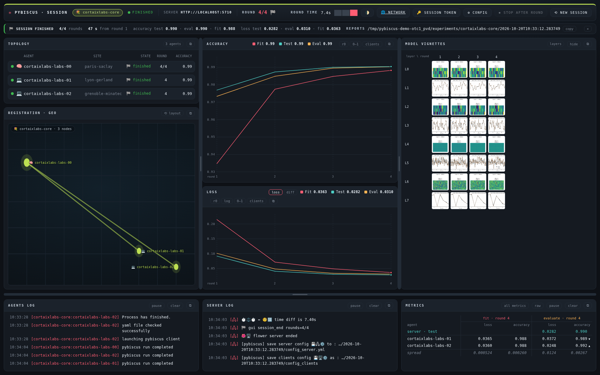

*Drop session* ends the session and empties the page, for a new one with the same agents (which
register again). The runs of its agents still going are stopped. In a hierarchical session, the
lower levels follow: a lower-level manager drops its own session (and stops its runs) as soon as it
learns that the upper level dropped its session or launched another one — within its 10 s
heartbeat —, and its page says so (*⚠ session dropped*); its operator launches it again. An upper
level out of reach changes nothing: it may come back.

### All the agents in one page

When testing a session on one machine, `3frames.html` (at the root of the repository, to open as a
file in the browser) shows the server agent and 1 to 9 client agents in one page, each on its
registration page: often handier than one tab per agent. Three layouts: grid (all side by side),
focus (one agent large, the others as live miniatures) and single. It expects the agents on
`localhost`, the server on port 5000 and the clients from 5001; its ⚙ panel or URL parameters
(`3frames.html?clients=3&mode=focus`) change that. Its labels are in French.

The URL picks the session, and each session's page keeps its own settings (layout, number of
clients), so that two sessions can be followed side by side:

| session | manager | page |
|---|---|---|
| `cortaixlabs-core` | `launch/session/run_manager.sh` (5555) | `3frames.html?server=5000&client=5001&clients=8&bouquet=cortaixlabs-core` |
| `cortaixlabs-edge1` | `launch/session/run_lower_level_manager.sh` (5556) | `3frames.html?server=5100&client=5101&clients=8&bouquet=cortaixlabs-edge1` |

With `bouquet`, the page takes the colour of its manager's page (tab icon, band, pill); add
`&color=…` when the manager was given `--color`.

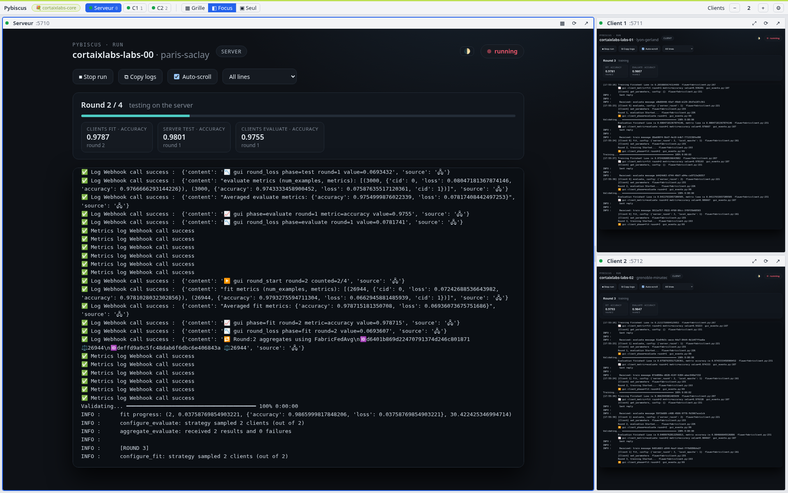

## Bouquets of a hierarchical session

*Under development: the managers are linked, the topology shown, and the levels train together
through a link the managers set, and dropping a session is passed down. A full experiment, with its
deployment diagram and screenshots: [Hierarchical session: one core, two edges](hierarchical-session.md).*

The plugins of these sessions (the relay client, the link decorator) are kept apart, in
`pybiscus-plugins-hierarchical/`, so that they do not appear in a simple session's forms. The agents
with a hierarchical role add its manifest (`launch/agent/cli/5007.sh`, `5008.sh` for the relays,
`5100.sh` for a lower-level server):
`PYBISCUS_PLUGIN_CONF_PATH=pybiscus-plugins/plugins-conf.yml:pybiscus-plugins-hierarchical/plugins-conf.yml`.

A manager started with `--upper-url` (and `--bouquet`) reports its bouquet to the upper-level
manager: its agents, their roles, states and locations, and the lower levels reporting to it in
turn. `launch/session/run_lower_level_manager.sh` starts `cortaixlabs-edge1` this way, reporting to
the manager of `run_manager.sh` (`PYBISCUS_UPPER_MANAGER_URL` for another one).

The upper-level page then shows the tree of the bouquets in its topology (each lower level indented
under its parent, its manager's address in the tooltip of its bouquet), and the lower levels' agents on its map, in
their bouquet's colour. The managers are drawn too, as diamonds, each dotted to its session's
server; a dashed line joins each lower
level's manager to its parent's (supervision; the federated learning links are the solid stars
between a server and its clients). A manager is placed with `--geo LAT,LON` (and named with
`--location`), else next to its session's server; the scripts place both at Palaiseau. The
lower-level page shows its upper level at the top of its topology and of its map.

On the map of any manager's page, a node (or its label) can be moved with the mouse to pull apart
the agents registered at the same place; a double click puts it back, *⟲ layout* puts them all
back. The registered coordinates do not change: only this page's drawing, kept by the browser.

The session is configured from the top: a lower level's session waits for its upper level's.
Until the upper-level session is launched, the lower-level manager keeps its ⚙ *Config* button
greyed out, and refuses to launch. Then its form opens with the upper level's **model (with
its hyperparameters), data and number of rounds** set and locked (models exchanged between the levels must be the same, and
each lower round answers one upper round), the rest of the
session (data partition, holdout, `min_clients`, robustness...) being its own; the manager also
imposes them whatever the form sends, and they reach the forms of its agents. A level in the middle
passes them on to its own lower levels.

Each lower level reaches the upper-level session through a **relay**: a client of the upper
session that computes nothing and stands for the lower session. The upper-level manager designates
it in its topology, for each lower level, among all its registered clients (agents register as
ordinary clients). It refuses to launch the session until every lower level has one, and no longer
changes them once the session runs. A relay gets no share of the data, no holdout and no CPU
threads, but counts in the minimum number of clients (the Flower server waits for it); its form
opens with the relay client set and locked. The lower-level manager shows which client relays it,
and the upper-level map draws the link between a relay and the server of its lower level.

**The link between the levels.** The relay (`flower_client.alternate_client_class`, `name: relay`)
and the lower level's server decorator `upperlevellink` (last of its `server_strategy.pipeline`,
refused elsewhere) share a link: a `directory` both reach (they run on the same machine; default
`/tmp/pybiscus-links`), a `link_id`, a `timeout` (seconds, default 3600). The managers set it: at
each launch the upper-level manager makes one link per lower level, with a new `link_id`
(`<upper bouquet>-<lower bouquet>-<time>`: files of an earlier run are never taken), sets it and
the relay plugin, locked, in the relay's form, and passes it down; the lower-level manager sets it,
locked, in its server's form as `server_strategy.upper_level_link`, which adds the decorator last
to the pipeline. From the command line, set the same values on both ends. Both sessions have the
same model and number of rounds; round `r`:

1. the upper server sends its model to its clients, the relay among them: the relay writes it to
   the directory and waits;
2. the lower server, waiting for that model, trains its round `r` on it and writes its aggregate
   with its number of examples and fit metrics;
3. the relay returns that aggregate as its own fit result, weighted by the lower level's examples.

The lower server waits for the upper model of round 1 from its start: its round 0 evaluation is
that of the model both levels start from. The relay answers the federated evaluation as a failed
client (it holds no data; the lower level evaluates every model on its own), and a round the lower
level could not aggregate, or a `timeout`, as a failed fit: the upper round goes on without it.
Files are `.npz` + JSON, written atomically and read once; the relay empties its `link_id` at start.
The relay loads no data (its machine may not hold the training set): the `data` section of its
configuration, still required, is not read.

**Cycles.** In a hierarchical session, the *Loss · metric diff* panel gets a *cycles* tab: one row
per level, this session first, then its lower levels indented (all the depths), one bar per round
(the last 20, of equal width). This session's bar is its whole round; a lower level's is the share
of that round it worked on it, from the upper model's arrival to its aggregate's departure, in red
when it failed; the tooltip gives the seconds and the examples. It shows which site holds the upper
rounds back. Each manager reads these times from its own server's log lines as they arrive, and
sends only durations up with its topology (at the end of each round): the sites' clocks need not
agree.

Several sessions on one machine need one Flower server port each: the session form proposes one
per manager (port 3333 for the manager on 5555, 3334 for the one on 5556...), and a Flower server
refuses to start on a port another server already listens to (left at the same port, two
sessions' servers would silently share their clients).

Several sessions can run from one directory on one machine: each agent keeps its uploaded
configuration (`configs/uploaded/<port>/`), its pinned server configuration
(`.pybiscus-cache/html-config/server-pin-<port>.json`) and the client run configurations a server
agent collects (`experiments/config_clients/<port>/`) apart, and the manager proposes, without
locking it, a reports directory per bouquet to its server (`${root_dir}/experiments/<bouquet>`, hence
one `current` link per session).

The whole topology is sent when it changes; between two changes, the lower level only sends a
heartbeat every 10 s. Silent for 30 s, it is shown as unreachable; an upper-level manager restarted
gets the topology again at the next heartbeat. When the upper-level manager requires tokens, give
its session token with `--upper-token` (or `PYBISCUS_UPPER_TOKEN`); a manager started from the same
directory on the same machine finds it on its own.

## Session parameters

The session configuration (server agent) has an optional `data_partition` block: when set, the
manager shares the training data between the clients registered when the session is launched, each
client getting its `partition_id` (its rank) and the number of partitions, locked in its form, along
with a stable `cid` equal to that rank.

Its optional `data_holdout` block (`fraction`, `seed`) makes every client validate on examples
held out of its own training share: the manager sets and locks `val.source: holdout`, `val.fraction`
and `val.seed` in each client's form, late clients included (data plugins with a holdout: cifar,
mnist, hdfs; turbofan validates on its own engines and ignores it).

The manager also sets and locks the server strategy's `min_fit_clients`, `min_evaluate_clients`
and `min_available_clients`: every round waits for that many clients (Flower's default of 2 let a
session of 7 clients start with the first 2 to connect, and the robust aggregations size their
defense on that number). By default it is the number of clients registered at launch, shown in the
header of the session configuration; a client that leaves the session then stalls the next round
(Flower waits up to 24 h). The optional `min_clients` field of the session form sets another
number, and the manager asks for a confirmation stating the risk when it differs from the clients
registered:
- fewer: rounds start as soon as that many clients are connected, possibly without the others,
  and a robust aggregation sizes its defense on fewer clients; in exchange, the others may leave;
- more: the first round waits for the missing clients, and clients registered after the launch get
  no share of the data partition.

Its optional `num_rounds` is set and locked in the server's form; unset, the server's form decides.
A session with lower levels must set it (the manager refuses to launch otherwise): they follow it
round for round.

Its `robustness` choice (`none` by default, or `safeguard`) is set and locked in the server's form:
`safeguard` adds a defense against malicious clients to the server's pipeline (see
[Robust aggregation](robust-aggregation.md#the-robustness-setting)).

These session values are set in every option of the forms that has the field, not only in the
selected one: switching the strategy or the data plugin afterwards keeps them.

Its `share_cpu_threads` setting (on by default) shares the CPU of each machine between the clients
running on it: each agent tells the manager its machine and number of physical cores when it
registers, and each client gets `client_compute_context.num_threads` = cores / clients on its
machine (still editable in its form). The server gets none, since it never computes at the same
time as the clients; with several sessions on one machine, set `server_compute_context.num_threads`
by hand (see [CPU threads](configuration.md#cpu-threads)). Without it, every PyTorch client takes all the cores: three
cifar10 clients on a 14-core machine took 233 s per round instead of 20 s.

## Access

The manager listens on 127.0.0.1 by default. When agents run on other hosts (they send it their
registration and logs), start it with `--host 0.0.0.0` (or a given address), e.g.
`launch/session/run_manager.sh --host 0.0.0.0`. For a session spread over several machines, see
[multi-machine.md](multi-machine.md).

### Access tokens

A component listening beyond the loopback (`--host 0.0.0.0` or an address) requires tokens:
whoever reaches a port opened to the network must not drive the session nor launch runs. On
127.0.0.1 (the default), it requires none, unless started with `--require-token` (a machine shared
with other users). Each component decides for itself: a client agent on 127.0.0.1 requires no
token, while the manager and the server agent it registers with, listening on the network, do.
It prints at start either `🔑 … open …?token=…`, or `🔓 … no token required`.

- **Access token of a component**: the manager and each agent have their own, for their pages and
  actions. Each prints, when it starts, the URL to open (`…?token=…`); the browser then keeps it in a
  cookie, and the page asks for it otherwise. The manager's is its administration token (launch or
  drop the session, follow it).
- **Session token**: the manager's, given to the participants (created even when the manager
  requires none, since a server agent listening on the network requires it from the others). An agent gives it at its
  registration (field *Session token* of its registration page, copied from the manager's
  🔑 button); it then presents it to the manager (registration, session parameters, logs), passes
  it to the runs it launches (webhooks), and accepts it from the other components (a client's run
  configuration, the session form opened by the manager). It does not open the manager's pages.

A token is kept, readable by its owner only, in `.pybiscus-cache/tokens/` of the directory where
the component was started: a restart keeps it (the browsers stay logged in). Delete the file to get
a new one, or give it:

| component | option | environment variable | file |
|---|---|---|---|
| manager (administration) | `--admin-token` | `PYBISCUS_MANAGER_TOKEN` | `manager-<port>-admin` |
| manager (session) | `--session-token` | `PYBISCUS_SESSION_TOKEN` | `manager-<port>-session` |
| agent | `--token` | `PYBISCUS_AGENT_TOKEN` | `agent-<port>` |

On the manager's machine, the agents and the runs started from the same directory find the session
token in its file: the registration page proposes it, and the webhooks of a run launched by hand
present it. Elsewhere, give it at the registration, or through `PYBISCUS_SESSION_TOKEN` (a run
launched by hand whose webhooks target the manager, or the `session_token` key of an agent's
registration configuration).

A scripted call presents the token as `Authorization: Bearer <token>` (see below).

Without TLS, the tokens travel in clear between machines: see [multi-machine.md](multi-machine.md).

### Requests from other sites

A page of another site open in the operator's browser must not drive the agents or the manager.
Every request that changes something (POST, PUT, PATCH, DELETE) must therefore carry the header
`X-Pybiscus: 1`, otherwise it is refused with a 403; the actions (registration, session run, run of
an agent) are never triggered by a GET. Pybiscus' pages and components add the header; a scripted
call must add it too, with the agent's token when it requires one, e.g. (see `launch/agent/mngt/*.sh`):

```bash
TOKEN=$(cat .pybiscus-cache/tokens/agent-5000)
curl -X POST -H "X-Pybiscus: 1" -H "Authorization: Bearer $TOKEN" http://localhost:5000/server/config -F file=@server.yml
curl -X POST -H "X-Pybiscus: 1" -H "Authorization: Bearer $TOKEN" http://localhost:5000/server
```

The registration page of an agent calls the manager from the agent's origin: the manager accepts
such cross-origin calls from local origins (`localhost`, `127.0.0.1`, `[::1]`, any port) only. When
agents are opened from other hosts, allow their origins, one option per origin:

```bash
launch/session/run_manager.sh --host 0.0.0.0 --allow-origin http://site-a.example:5001
```

The header protects against other sites; the tokens (above) against whoever reaches the ports.
