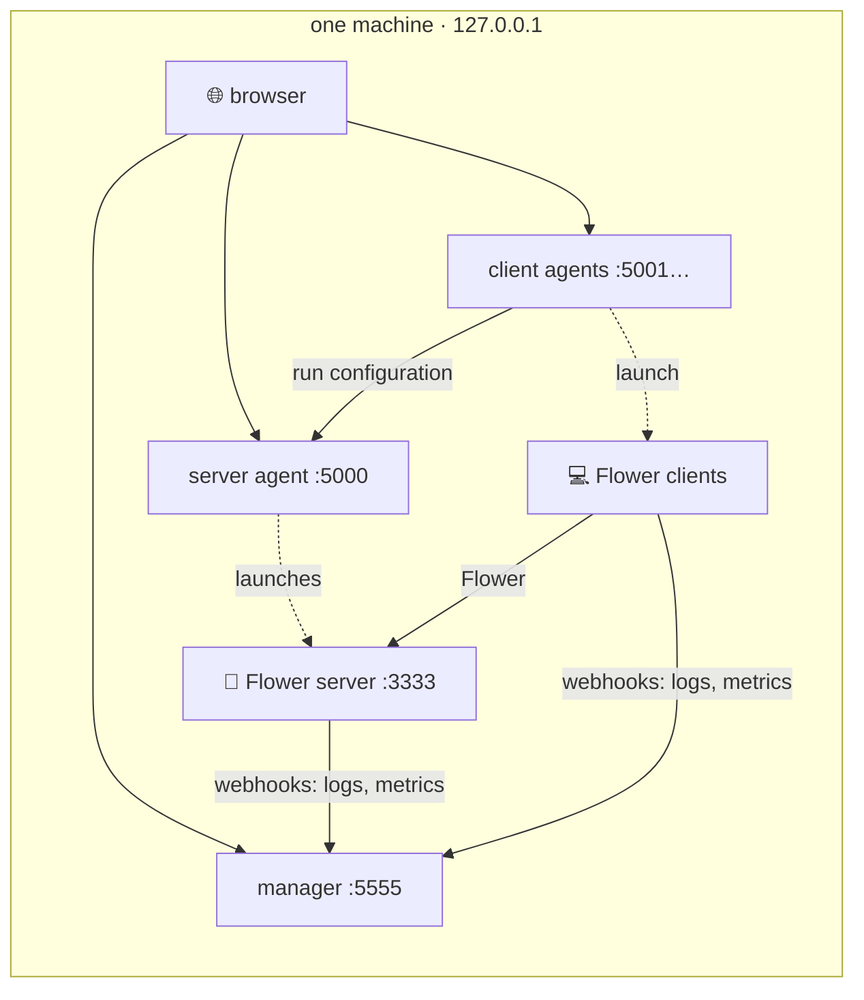
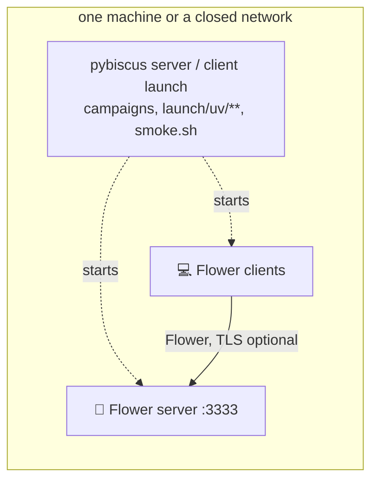
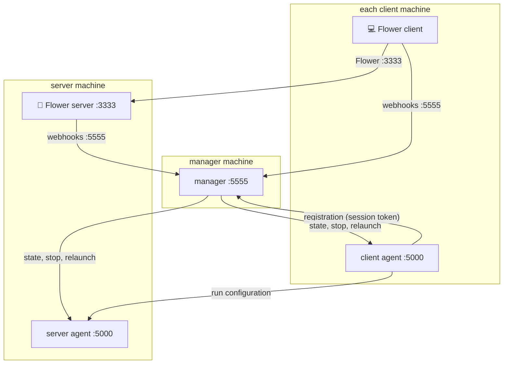
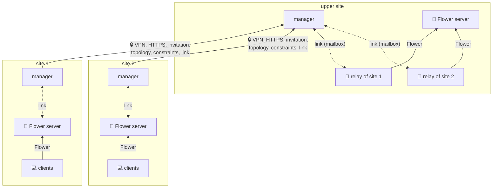
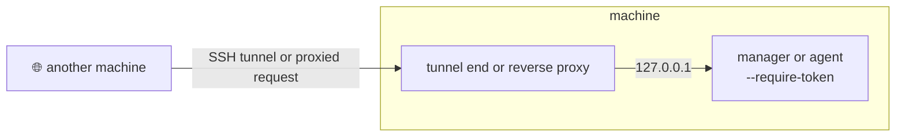

# Usage scenarios

Pybiscus runs the same federated session on one laptop, on the machines of a lab, or across
several organisations. What it brings, what has to be set up and what its results mean change from
one to the other. This page describes the typical scenarios; the other pages give the details of
each component, and [security.md](security.md) what is protected in each.

## Two questions

Each scenario answers two questions:

- **Who can reach the components?** Everything on one machine (the loopback), a closed network (a
  lab, a classroom, a cluster, a VPN), or an open network.
- **How far are the participants trusted?** One team; partners who follow the protocol but may try
  to learn from what they receive (*honest but curious*); participants who may send poisoned
  updates (*malicious*).

|  | one team | honest but curious partners | possibly malicious participants |
|---|---|---|---|
| **one machine** | [experimenting](#experimenting-on-one-machine), [automated runs](#automated-runs-without-a-browser) | — | [attack and defence studies](#attack-and-defence-studies) |
| **closed network** | [lab, classroom, cluster](#several-machines-on-a-closed-network) | [consortium over a VPN](#several-organisations) | [consortium over a VPN](#several-organisations) |
| **open network** | — | [several organisations](#several-organisations) | [several organisations](#several-organisations) |

The first question is about access: the [tokens](sessionmanager.md#access-tokens) and the
[encryption](multi-machine.md#encryption) of the manager and the agents. The second is not:
an admitted participant holds the session's tokens. Against it, Pybiscus has
[robust aggregation](robust-aggregation.md) for poisoned updates, server-side differential privacy
and the [privacy evaluation](privacy-evaluation.md) for curious partners.

## What the scenario decides

| | what changes |
|---|---|
| **connectivity** | who must reach whom ([table](multi-machine.md#who-calls-whom)), which ports are open, what a firewall, a NAT or a proxy cuts |
| **operation** | one operator for everything or one per site; a browser tab to launch a session, or agents [launched by order](sessionmanager.md#launched-by-order); restarts |
| **resources** | memory and GPU shared by every process on one machine; network time per round across sites |
| **consistency of the settings** | how many forms are filled by how many operators: the [usual mistakes](#common-mistakes) grow with the sites |
| **meaning of the results** | simulated shares of one dataset (reproducible) or real data of each site (not reproducible) |
| **data governance** | what leaves each site, and where the reports are kept |
| **setup** | nothing on one machine; tokens, certificates and open ports across machines |

**What leaves a site**, in every scenario: the model updates (to the Flower server); the metrics of
each client, its number of examples included (to the server and the manager); the logs of its runs
(to the manager); its run configuration, whole, with its local paths (to the server agent, kept in
the server's reports). The training data never leaves it.

## Experimenting on one machine

**Use**: trying a model, a dataset, a strategy; preparing a session before spreading it; on a
personal machine or on one shared with other accounts.

**What Pybiscus brings**: a session from the [CLI](cli.md) and YAML files, or from the
[agents](agent.md) and the [session manager](sessionmanager.md) without writing YAML; the
consistency of the clients' settings (model, data, how the data is shared, number of clients,
rounds) set once in the session form; the data shared between simulated clients by configuration
(iid, dirichlet, shards) with seeds.

**Setup**: none. Every component listens on 127.0.0.1 and requires no token. On a machine shared
with other user accounts (a lab server, a compute node), start the manager and the agents with
[`--require-token`](sessionmanager.md#access-tokens): on 127.0.0.1, every account of the machine
reaches their ports.

**Limits**:
- Memory bounds the number of clients: each is a process with its model and its data (cifar10, 20
  clients: about 1.2 GB each, see [robust-aggregation.md](robust-aggregation.md)). The GPU is shared
  by all of them.
- The results come from shares of one dataset: they compare strategies, they do not predict a
  session on real sites.

**Security**: [checklist](security.md#experimenting-on-one-machine).

## Automated runs without a browser

**Use**: [campaigns](campaigns.md) comparing strategies, continuous integration
(`launch/ci/smoke.sh`), scripted sessions (`launch/uv/**`).

**What Pybiscus brings**: the server and the clients launched from YAML files, the campaign tool
running variants and seeds and gathering the results.

**Setup**: the CLI only; no manager, no agent.

**Limits**:
- A session of the manager needs a browser for the registrations and the session form. The agents
  started with `--accept-launch` are then [launched by order](sessionmanager.md#launched-by-order),
  without a tab; the others from their pages. A [repeated session](sessionmanager.md#repeated-sessions)
  is launched again by the manager alone.
- The CLI has no tokens: only the [TLS of Flower](multi-machine.md#flower) protects its traffic.
  Keep it on one machine or a closed network.

**Security**: [checklist](security.md#automated-runs-without-a-browser).

## Attack and defence studies

**Use**: measuring how a strategy resists malicious clients.

**What Pybiscus brings**: the `byzantine` client (sign flipping, scaling, ALIE, label flipping),
the robust strategies and decorators, campaigns with several seeds
([robust-aggregation.md](robust-aggregation.md)).

**Limits**: the attackers are simulated, on one machine; the participants are the operator's own.

**Security**: [checklist](security.md#attack-and-defence-studies).

## Several machines on a closed network

**Use**: the machines of a lab, a classroom, a test bench, containers or a cluster.

The manager may run on the server machine. The operators' browsers are left out: each opens its
own agent's pages and the manager's ([who calls whom](multi-machine.md#who-calls-whom)).

**What Pybiscus brings**: in addition to the above, the agents register with the manager as they
start; the manager's page shows who is there, their states, their metrics and a
[network view](sessionmanager.md#network-view) of the flows and their problems.

**Setup** ([multi-machine.md](multi-machine.md)):
- One agent per machine, with the machine's role (server or client); the manager on the server's
  machine or on its own.
- The manager and the agents listen beyond the loopback (`--host 0.0.0.0`): they then require
  their tokens. Open their pages with the URL they print (`…?token=…`), give the session token to
  each agent's operator. The tokens are kept from one start to the next.
- The URLs name the machines, not `localhost`.
- Ports open: the manager, the agents, the Flower server.
- Encryption: without it, the tokens and the configurations travel in clear. On a network shared
  with others, use the [built-in HTTPS](multi-machine.md#encryption) or a VPN.

**Limits**: one operator usually runs the whole session; several operators fill several forms
(see [common mistakes](#common-mistakes)).

**Containers and orchestrators**: the images of the `pybiscus` command and of the agent, and
scripts to run them, are described in [containers.md](containers.md). A cluster (Kubernetes...) is
a closed network of this kind, its network policies limiting the flows to
[who calls whom](multi-machine.md#who-calls-whom). The CLI suits it: the Flower server as a service,
the clients as jobs, the configurations and each client's data mounted. A session of the manager
fits less: the tokens must outlast a restart (a persistent volume), and the registrations and the
session form need a browser (agents started with `--accept-launch` then launch without one). No manifest
is provided or tested yet.

**Security**: [checklist](security.md#several-machines-on-a-closed-network).

## Several organisations

**Use**: sites that keep their data (hospitals, companies), each run by its own operator.

A hierarchical session, the agents left out: each site, invited by the upper level, is a closed
network of its own, and its relay runs at the upper site; only the lower managers reach the upper
one. Without a hierarchy, the sites are the machines of the closed network above, joined by the VPN.

> **Status.** This scenario works: sessions with one manager per site, hierarchical ones included,
> run over HTTPS. They have been run with every site on one machine; a run across the machines of
> separate sites is still to come.
>
> **Its security guarantees are those of a closed network, not of an open one.** Flower's TLS
> authenticates the server, not the clients. Keep the sites on a VPN, and do not expose the manager
> or the agents directly to the Internet.
>
> Each agent is [invited](sessionmanager.md#agents-invitations) by its manager and, between the
> managers of a hierarchical session, each site by the upper level
> ([invitations](sessionmanager.md#invitations)): a token of its own, bound to its name and role or
> to its bouquet, expiring and revocable, in place of the session token shared by every participant;
> each manager lists the agents or sites expected, present and refused; the web components run on a
> production server ([cheroot](security.md#the-manager-and-the-agents)). See
> [security.md](security.md#known-limits).

**What Pybiscus brings**: each site's operator sees and checks its form before running; the session
form sets and locks what must be shared; [hierarchical sessions](hierarchical-session.md) give each
site its own manager, the upper level imposing its model, its data plugin and its number of rounds
on the lower ones.

**Setup**:
- HTTPS between the components, with a CA for the session and one certificate per machine (the
  key stays on its machine: [multi-machine.md](multi-machine.md#certificates)).
- A **VPN between the sites** (see the status above), letting through only the
  [flows across sites](security.md#across-sites).
- In a hierarchical session, each link is its own scenario: inside a site, a closed network; between
  the sites, the managers of the lower levels reach the upper one. The upper level
  [invites](sessionmanager.md#invitations) each site (`session_manager invite`), and refuses the
  others with `--require-invitation`; an invited site's relay runs at the upper site.
- Each manager [invites](sessionmanager.md#agents-invitations) its agents (`session_manager invite
  --agent`), and refuses the others with `--require-agent-invitation`.

**Against the participants**: [robust aggregation](robust-aggregation.md) if some may be malicious;
[differential privacy](configuration.md#server-side-differential-privacy) if partners are curious,
and the [privacy evaluation](privacy-evaluation.md) to measure what a model reveals.

**Limits**: the results depend on who took part (a client registered after the launch gets no
share of a partition); no session can be reproduced exactly.

**Security**: [checklist](security.md#several-organisations).

## Behind a tunnel or a reverse proxy

An SSH tunnel or a reverse proxy on the same machine lets a component listen on 127.0.0.1 while
others reach it: it then requires no token. **Start it with
[`--require-token`](sessionmanager.md#access-tokens).** Without it, a component refuses the
requests under another name than the loopback's (a reverse proxy passing its own host name), not
those of an SSH tunnel, which arrive as `localhost`. A reverse proxy also has to pass the long requests (the runs' event streams, the links' waits of up to a minute).

**Security**: [checklist](security.md#behind-a-tunnel-or-a-reverse-proxy).

## Common mistakes

The more sites and operators, the more of these; the checks of the forms and the manager's
network view catch some of them.

| mistake | effect |
|---|---|
| a URL left on `localhost` across machines (`manager_url`, `agent_url`, webhooks) | the component calls itself, without an error message |
| `server_host` of the session form left on `localhost` | each client looks for the server on its own machine |
| `server_host` not among the names of the server's certificate | the clients refuse the TLS connection |
| two sessions on one machine with the same Flower port | the second server refuses to start ([sessionmanager.md](sessionmanager.md#bouquets-of-a-hierarchical-session)): each manager proposes its own port |
| a link `directory` between two machines | the relay and the lower server never see each other's files: use the `manager` transport |
| `min_clients` above the clients that will come | the first round never starts |
| an agent registering with another bouquet than the manager's | refused (or only warned, `--bouquet-mismatch warn`) |
